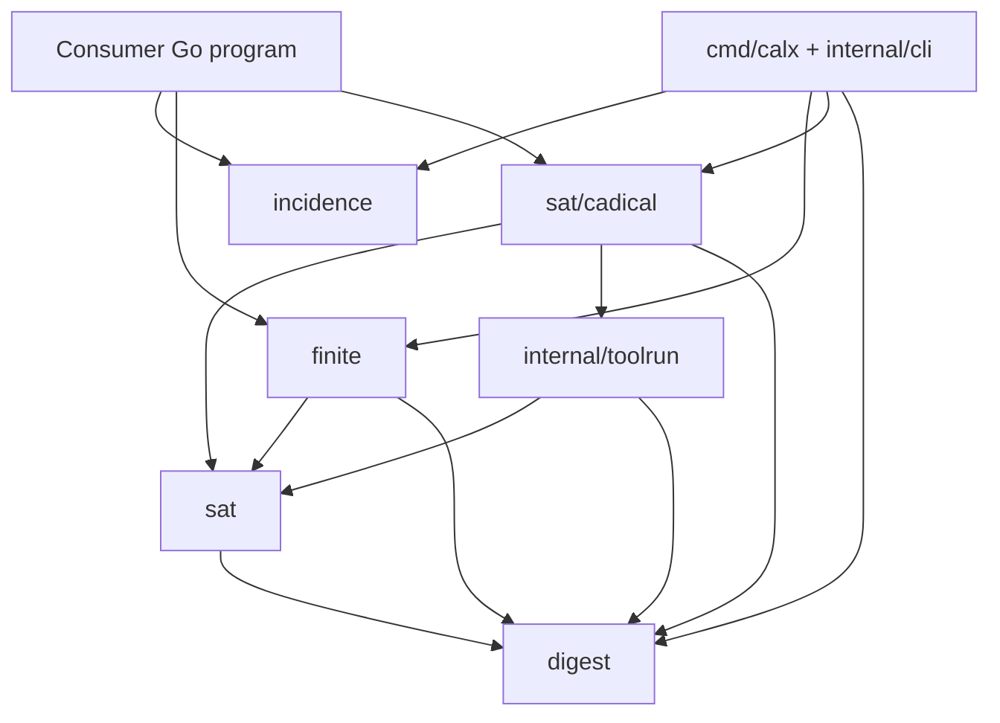
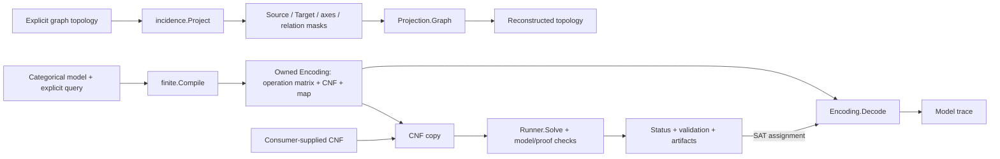

# Architecture

Calx is one module with separately importable packages and a thin CLI. Public
packages depend on neither AHE nor Pouch. The current implementation has no
third-party Go dependency. `sat/cadical` uses `internal/toolrun` and `sat`;
`finite` uses `sat`; `incidence` is independent of both. The leaf package
`digest` owns content identifiers, their current algorithm and textual format.
`finite`, `sat`, `sat/cadical`, tool execution and CLI code use that shared type.
CLI wiring lives in `internal/cli` and `cmd/calx`.

## Package dependencies

Arrows mean “imports”; consumers choose the packages they need.

## Data flow

The [illustrated internal execution flow](execution-flow.md) follows concrete
functions, an exact CNF example, solver verification and result decoding.

Arrows here mean “produces or supplies data.” The two matrix routes have
separate inputs and meanings.

The finite Decode route requires its matching Encoding. A raw CNF consumer uses
its own interpretation map. Full structures and JSON fields are documented in
[data structures](data-structures.md); see [graph-to-matrix](graph-to-matrix.md)
for the topology projection steps.

## Matrix meanings

Two matrix meanings are deliberately explicit:

- `incidence.Projection`: node rows, independently identified edge columns,
  separate source/target matrices and opaque relation masks. It preserves
  topology, including isolated nodes, self-loops and parallel edges. Full source
  records, derivation manifests, provenance, scope and truncation stay in caller
  sidecars. A round trip is not a new snapshot identity or a completeness claim.
- `finite.Matrix`: action rows, categorical coordinates for guard/effect columns,
  and field columns for frames. Zero guard cells impose no requirement. The
  matrix needs its axes and forbidden patterns to reconstruct a finite model.

An incidence matrix alone cannot determine the semantics of a SAT formula.
AHE's normalized declarations retain their own compiler. Pouch's categorical
model can use `finite`; Lab typed/copy profiles retain their own encoders and
submit their CNF through the CLI. No silent bool/int/string coercion is supported.

`finite` owns pure model validation and single-query encoding/decoding. Caller
policy decides horizons, enumeration, stopping conditions, recovery targets and
acceptance of a collection. Every v1 query explicitly selects simple first-hit
semantics and exact length; UNSAT is relative to that formula, including its
blocking clauses. Independent original-rule receivers remain outside Calx.

The CLI is a transport/composition boundary, not a server. Its versioned JSON
and DIMACS interfaces are implemented now. Protobuf generation is deferred:
freeze semantic profiles and mappings before introducing a second wire format.
A future codec can depend on generated DTOs and public Calx types; algorithms
need not depend on generated types. Existing AHE/Pouch formats and frozen Lab
artifacts are not rewritten by this module.

There is no SMT, arbitrary numerical matrix algebra, physics, automatic source
interpretation, execution, persistence, or evidence-admission API in v0.
