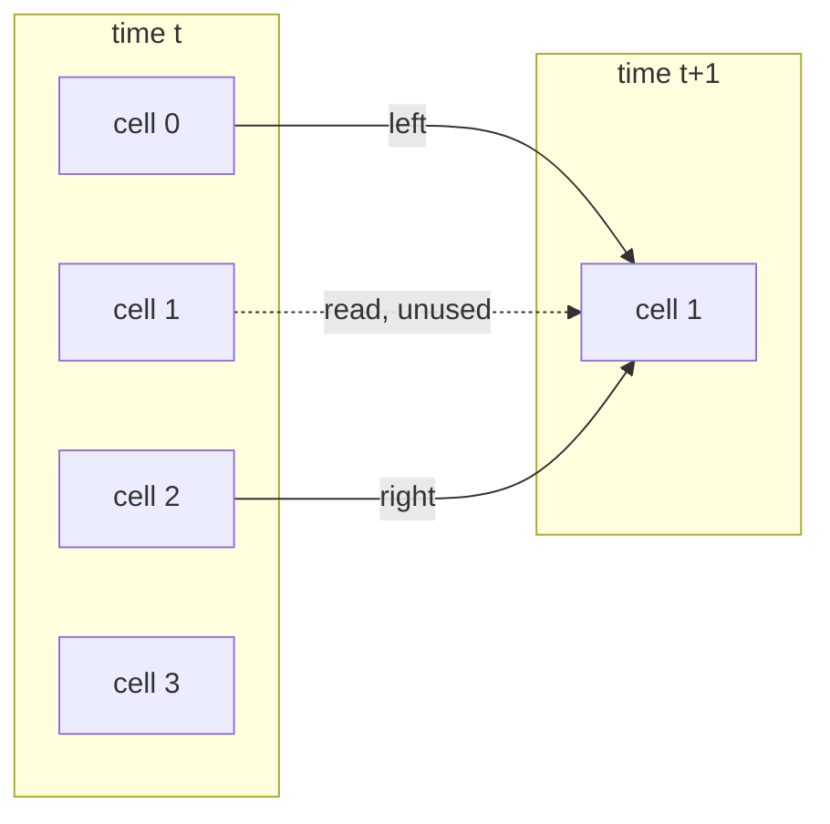
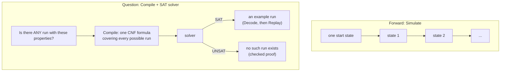
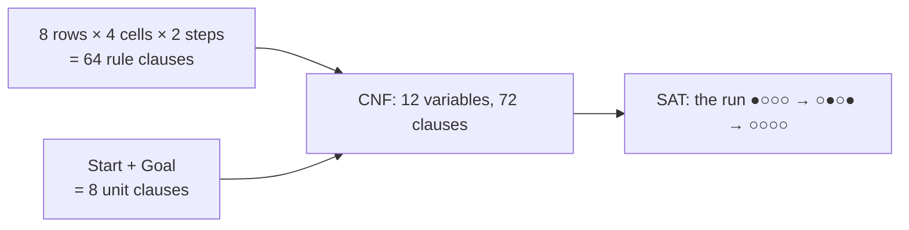
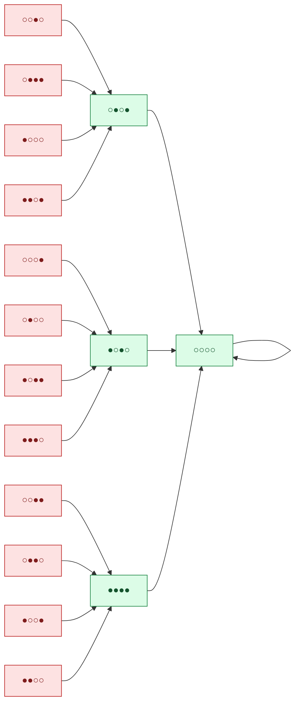

# Automata primer

This page explains, with pictures, what the `automaton` package does. It uses
one small system throughout: elementary rule 90 on a ring of four cells. Every
state, variable number and clause below was printed by Calx itself, not worked
out by hand. [`automaton/primer_test.go`](../automaton/primer_test.go) checks
them without a SAT solver, so `go test` fails if they stop being true.

For the exact rules see [contracts](contracts.md#synchronous-boolean-automata-v01);
for the code path see [execution flow](execution-flow.md#5-automata-and-lattice-gases).

## 1. A row of cells that update together

A synchronous Boolean automaton is a fixed set of cells, each holding a few
bits. At every step **all cells update at once**, and each new bit depends only
on some bits of the previous state.

Rule 90 has one bit per cell (● = true, ○ = false). A cell's next value is its
left neighbor XOR its right neighbor; the ring wraps around, so cell 0's left
neighbor is cell 3.



Every cell does the same at the same moment, reading only time t. Starting from
one live cell:

| Time | Cell 0 | Cell 1 | Cell 2 | Cell 3 |
| ---: | :---: | :---: | :---: | :---: |
| 0 | ● | ○ | ○ | ○ |
| 1 | ○ | ● | ○ | ● |
| 2 | ○ | ○ | ○ | ○ |
| 3 | ○ | ○ | ○ | ○ |

The caller describes such a system with four methods, and Calx never learns
what a cell means:

| `System` method | Rule 90 on four cells |
| --- | --- |
| `Cells()` | 4 |
| `Bits()` | 1 |
| `Inputs(c)` | left neighbor, cell c itself, right neighbor |
| `Next(c, in, out)` | `out[0] = in[0] XOR in[2]` |

`lga.HPP` and `lga.FHP` are the same idea with more bits per cell: one bit per
direction, true when a particle moves that way.

## 2. Two ways to use it



`Simulate` answers "what happens from here?" for one start. A query asks about
**all** starts at once:

| Question | `Query` |
| --- | --- |
| Can A become B in 3 steps? | `Steps: 3, Start: A, Goal: B` |
| Does state S have a predecessor? | `Steps: 1, Goal: S` |
| Can the quantity Q change at any step within k steps? | `Steps: k, Violates: Q` |

## 3. How Compile turns a run into a formula

**One variable per bit per time.** The query "from ●○○○, reach ○○○○ in two
steps" needs 3 times × 4 cells = 12 variables. Variable `1 + t·cells + c`
holds cell c at time t:

| Time | Cell 0 | Cell 1 | Cell 2 | Cell 3 |
| ---: | ---: | ---: | ---: | ---: |
| 0 | x1 | x2 | x3 | x4 |
| 1 | x5 | x6 | x7 | x8 |
| 2 | x9 | x10 | x11 | x12 |

**One clause per row of the rule table.** Compile calls `Next` once for each of
the 2³ = 8 input combinations of a cell and turns each row into a clause. For
cell 1 from time 0 to 1 (inputs x1, x2, x3; output x6):

| x1 (left) | x2 | x3 (right) | x6 = left XOR right | Clause |
| :---: | :---: | :---: | :---: | --- |
| ○ | ○ | ○ | ○ | `x1 ∨ x2 ∨ x3 ∨ ¬x6` |
| ● | ○ | ○ | ● | `¬x1 ∨ x2 ∨ x3 ∨ x6` |
| ○ | ● | ○ | ○ | `x1 ∨ ¬x2 ∨ x3 ∨ ¬x6` |
| ● | ● | ○ | ● | `¬x1 ∨ ¬x2 ∨ x3 ∨ x6` |
| ○ | ○ | ● | ● | `x1 ∨ x2 ∨ ¬x3 ∨ x6` |
| ● | ○ | ● | ○ | `¬x1 ∨ x2 ∨ ¬x3 ∨ ¬x6` |
| ○ | ● | ● | ● | `x1 ∨ ¬x2 ∨ ¬x3 ∨ x6` |
| ● | ● | ● | ○ | `¬x1 ∨ ¬x2 ∨ ¬x3 ∨ ¬x6` |

Read a clause as "if the inputs are this row, the output must be this value".
For example `¬x1 ∨ x2 ∨ ¬x3 ∨ ¬x6` says: if x1 is true, x2 false and x3 true,
then x6 is false.

**Then the question itself.** Start and Goal become one-literal clauses
(`x1`, `¬x2`, `¬x3`, `¬x4` and `¬x9` … `¬x12`).



Any satisfying assignment is exactly a valid run that meets the query, and
every valid run that meets it is a satisfying assignment. `Violates` adds
counting circuits (totalizers) that compare the quantity before and after
every step; counting is also why large conservation proofs are slow
([measured limits](validation.md#measured-conservation-proofs-are-counting-arguments)).

## 4. Garden of Eden states

A **Garden of Eden** state has no predecessor: no state reaches it in one step,
so it can only ever appear as a starting state. The name (Moore, 1962) refers
to something created rather than born from what came before.

For rule 90 on four cells, all 16 states lead to only 4 states. Green states
have predecessors; the 12 red states have none:



**Why so many?** On a ring of four, cells 0 and 2 both compute
`cell 3 XOR cell 1`, and cells 1 and 3 both compute `cell 0 XOR cell 2`. After
one step, cell 0 always equals cell 2 and cell 1 always equals cell 3, so a
state such as ○○○● (cell 1 ≠ cell 3) can never be produced. The start state
●○○○ in section 1 is itself a Garden of Eden state.

**The pigeonhole view.** 16 states map onto 4, so some states have several
predecessors (○●○● has four) and others must have none. In general a finite
system has Garden of Eden states exactly when two different states can step to
the same state, that is, when the rule is not reversible. HPP without walls is
reversible: streaming only moves particles and every collision can be undone
(`TestTimeReversal` in `lga` checks this), so every such HPP state has exactly
one predecessor.

**Asking Calx.** With every bit of S given as the goal:

```go
q := automaton.Query{Steps: 1, Goal: S}
```

UNSAT proves that S is a Garden of Eden state; SAT returns a predecessor in the
decoded `Trajectory.States[0]`. With the pinned CaDiCaL and DRAT-trim, ○○○● and
●○○○ are UNSAT with checked proofs, while ○●○● is SAT and ●●●● is SAT. The
solver returned the predecessors ○○●○ and ○○●●; each of these states has four
predecessors (see the graph above), and another solver may return a different
one. The solver never lists all 2ⁿ states, so the same question
stays answerable for rows far too large to enumerate.
