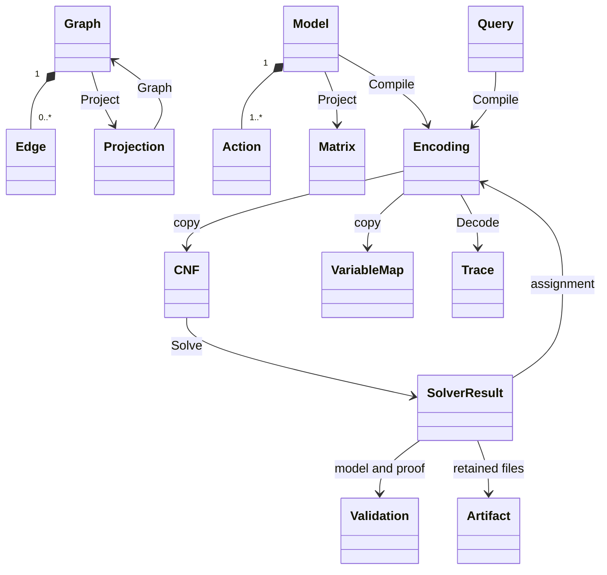
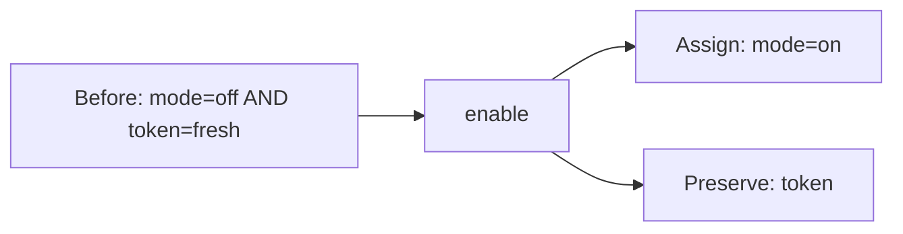

# Data structures

This reference describes the public Go types and the implemented JSON boundary.
Use it to build inputs, interpret results and retain the mappings between them.
[Contracts](contracts.md) covers validation rules, limits and guarantee details;
[graph-to-matrix](graph-to-matrix.md) walks through a complete projection.
The [execution-flow diagrams](execution-flow.md) show when each structure is
created, checked and consumed.

## Overview

`Graph`/`Projection` refer to `incidence`; `Model` through `Trace` refer to
`finite`; `CNF`/validation/artifacts refer to `sat`. `VariableMap` in the diagram
means `[]finite.Variable`. `SolverResult` means `cadical.Result`.

Matrix array indices and time indices are zero-based. CNF variable IDs are
one-based. IDs such as `a`, `e1` and `enable` are caller-chosen strings, not
array positions.

## Graphs and incidence projections

Source: [incidence/incidence.go](../incidence/incidence.go).

### `incidence.Graph` and `incidence.Edge`

| Go field | JSON key | Go type | Meaning |
| --- | --- | --- | --- |
| `Graph.NodeIDs` | `node_ids` | `[]string` | All included nodes, including isolated nodes |
| `Graph.Edges` | `edges` | `[]Edge` | Independently identified directed edges |
| `Edge.ID` | `id` | `string` | Edge identity; parallel edges have distinct IDs |
| `Edge.From` | `from` | `string` | Source node ID |
| `Edge.To` | `to` | `string` | Target node ID; may equal From |
| `Edge.Relation` | `relation` | `string` | Opaque edge label |

IDs and labels are nonempty UTF-8 strings; node/edge IDs are unique within their
own spaces. Endpoints must name included nodes. Input order need not be sorted.
These types have no payload, snapshot or provenance fields.

### `incidence.Projection`

Let N be the node count and E the edge count.

| Go field | JSON key | Go type / shape | Meaning |
| --- | --- | --- | --- |
| `NodeIDs` | `node_ids` | `[]string`, N | Row index → node ID |
| `EdgeIDs` | `edge_ids` | `[]string`, E | Column index → edge ID |
| `Source` | `source` | `[][]int`, N × E | 1 at each edge's source row |
| `Target` | `target` | `[][]int`, N × E | 1 at each edge's target row |
| `RelationMasks` | `relation_masks` | `map[string][]int`, E cells per label | Relation label → edge-membership row |

Project returns sorted axes and new slices. Graph reconstructs from the supplied
axes, requiring a unique source, target and relation for every edge. A cell is
an integer 0 or 1, not a floating-point weight or a probability.

`incidence.Limits` is a Go configuration type, not a CLI JSON input:

| Field | Unit | Zero selects |
| --- | --- | ---: |
| `MaxNodes` | Nodes | 4,096 |
| `MaxEdges` | Edges | 8,192 |
| `MaxCells` | Cells across both incidence matrices and all relation masks | 4,000,000 |

## Finite models and operation matrices

Sources: [model.go](../finite/model.go), [matrix.go](../finite/matrix.go),
[cnf.go](../finite/cnf.go), [variable.go](../finite/variable.go).

### `finite.State`, `finite.Action`, `finite.Model`

`State` is `map[string]string`: field name → categorical value. A complete state
assigns every model field. Guards, goals and forbidden patterns can be partial.

| Go field | JSON key | Go type | Meaning |
| --- | --- | --- | --- |
| `Model.Fields` | `fields` | `map[string][]string` | Field name → allowed categorical values |
| `Model.Forbidden` | `forbidden` | `[]State` | Any matching pattern excludes a complete state |
| `Model.Actions` | `actions` | `[]Action` | Declared transitions |
| `Action.ID` | `id` | `string` | Unique action identity |
| `Action.Guard` | `guard` | `State` | All listed equalities must hold before the action |
| `Action.Effect` | `effect` | `State` | Constant values assigned after the action |
| `Action.Frame` | `frame` | `[]string` | Fields that retain their previous values |

Effect and Frame exactly partition the model fields. Omitted guards impose no
condition; effects cannot be empty. String `"1"` is a category, not integer 1.
The profile does not coerce JSON booleans, numbers or copy expressions to strings.

### `finite.Query` and `finite.Options`

| Go field | JSON key | Go type | Meaning |
| --- | --- | --- | --- |
| `Query.Profile` | `profile` | `string` | Must be `categorical-simple-first-hit/v1` |
| `Query.Start` | `start` | `State` | Complete domain-valid initial state |
| `Query.Goal` | `goal` | `State` | Nonempty target pattern |
| `Query.Horizon` | `horizon` | `int` | Exact number of actions, including zero |
| `Query.Blocked` | `blocked` | `[][]string` | Complete action sequences to exclude |
| `Options.MaxVariables` | `max_variables` | `int` | Encoding budget; zero selects 100,000 |
| `Options.MaxClauses` | `max_clauses` | `int` | Encoding budget; zero selects 1,000,000 |

The CLI request is `{model, query, options?}`. Its decoder separately tracks
Horizon presence: omitting it is an error, while explicitly setting 0 requests
zero transitions. Blocked may be omitted; each supplied sequence must have
exactly Horizon actions. `[[]]` blocks the empty sequence when Horizon is 0.

### `finite.Coordinate` and `finite.Matrix`

A Coordinate has `Field string` (`field`) and `Value string` (`value`).
For F fields, K field/value coordinates and A actions:

| Go field | JSON key | Go type / shape | Meaning |
| --- | --- | --- | --- |
| `Fields` | `fields` | `[]string`, F | Frame-column index → field |
| `Coordinates` | `coordinates` | `[]Coordinate`, K | Guard/effect-column index → field/value pair |
| `ActionIDs` | `action_ids` | `[]string`, A | Row index → action |
| `Guard` | `guard` | `[][]int`, A × K | 1 means this category is required |
| `Effect` | `effect` | `[][]int`, A × K | 1 means this category is assigned |
| `Frame` | `frame` | `[][]int`, A × F | 1 means this field is preserved |

Project sorts fields, values within each field, and action IDs. Matrix.Model
also needs the explicit forbidden patterns; they are not encoded in these three
matrices. Matrix itself is available through the Go API; CLI encode returns CNF
and mappings, not a Matrix field.

For example, let `mode = {off,on}` and `token = {fresh,used}`. Action `enable`
requires `mode=off AND token=fresh`, assigns `mode=on`, and frames `token`:

| Operation row | mode/off | mode/on | token/fresh | token/used |
| --- | ---: | ---: | ---: | ---: |
| Guard[enable] | 1 | 0 | 1 | 0 |
| Effect[enable] | 0 | 1 | 0 | 0 |

| Frame row | mode | token |
| --- | ---: | ---: |
| Frame[enable] | 0 | 1 |

A zero Guard cell means “no requirement here,” not “this value is false.” A
zero Effect cell means “no assignment here,” not “clear this value.” Token stays
unchanged because Frame selects it. Exactly-one category constraints and the
action rules supply the complete transition semantics.

### `finite.Encoding`, `finite.Variable`, `finite.Trace`

Encoding has private fields and is created by Compile. Its public accessors are:

| Method | Return | Meaning |
| --- | --- | --- |
| `CNF()` | `sat.CNF, error` | Independent copy of the compiled formula and metadata |
| `Variables()` | `[]finite.Variable, error` | Copy of the variable-to-model mapping |
| `Digest()` | `string, error` | Content digest of the serialized model and query |
| `Decode(assignment)` | `Trace, error` | Check assignment against the owned CNF, then decode |

Each finite Variable has:

| Go field | JSON key | Type | Meaning |
| --- | --- | --- | --- |
| `ID` | `id` | `int` | One-based DIMACS variable ID |
| `Kind` | `kind` | `VariableKind` | StateVariable, ActionVariable or DifferenceVariable |
| `Time` | `time` | `int` | State time or action transition start |
| `OtherTime` | `other_time` | `*int` | Required later state time for different; nil for other kinds |
| `Field` | `field` | `FieldName` | Declared state/difference field; absent for action |
| `Value` | `value` | `Category` | Declared category for state; absent for other kinds |
| `Action` | `action` | `ActionID` | Required declared action for action; absent for other kinds |

`Variable.Validate(model, horizon)` enforces the [role-specific presence and
membership rules](error-handling.md#variable-roles). Action names remain
caller-defined, but a variable must refer to a declared Model action. All
Encoding accessors return an error for nil/uninitialized encodings.

A `different` helper witnesses inequality when true; false alone does not assert
equality. Helpers do not define path identity. The mapping is also serialized as
a JSON string under `sat.Variable.Metadata["finite_variable"]`.

Trace contains `States []State` (`states`) and `Actions []string` (`actions`).
A trace with H actions contains H+1 complete states. It is a model witness;
original-rule replay and real execution remain separate checks.

## CNF, assignments and verification records

Sources: [sat/cnf.go](../sat/cnf.go), [sat/result.go](../sat/result.go),
[sat/limits.go](../sat/limits.go), [cadical/runner.go](../sat/cadical/runner.go).

### `sat.CNF` and `sat.Variable`

| Go field | JSON key | Go type | Meaning |
| --- | --- | --- | --- |
| `CNF.Variables` | `variables` | `[]Variable` | Contiguous IDs 1 through N |
| `CNF.Clauses` | `clauses` | `[][]int` | AND of clauses; each clause is an OR of signed literals |
| `CNF.Origins` | `origins` | `[][]string` | Optional clause → contributing consumer IDs |
| `Variable.ID` | `id` | `int` | One-based variable identity |
| `Variable.Metadata` | `metadata` | `map[string]string` | Optional opaque mapping; no logical force |

For `[[1,-2],[2]]`, the formula is `(x1 OR NOT x2) AND x2`.
`clauses: []` is true; `clauses: [[]]` is false. Literal 0 is not a variable:
it terminates a clause only in DIMACS text. If Origins is supplied, it has one
row per clause. Multiple origin IDs do not implicitly create AND constraints.

An assignment is `map[int]bool` in Go, or an object such as
`{"1":true,"2":false}` in JSON. SAT checking requires every declared variable
exactly once, including false values and variables absent from all clauses.

### `sat.Result` and `cadical.Result`

| Go field | JSON key | Go type | Meaning |
| --- | --- | --- | --- |
| `Status` | `status` | `sat.Status` | Backend answer: SAT, UNSAT or UNKNOWN |
| `Profile` | `profile` | `string` | Current runner formula profile: `cnf/v0` |
| `InputSHA256` | `input_sha256` | `string` | Exact generated input.json identity |
| `FormulaSHA256` | `formula_sha256` | `string` | Exact generated input.cnf identity |
| `SolverSHA256` | `solver_sha256` | `string` | Pinned solver executable identity |
| `CheckerSHA256` | `checker_sha256` | `string` | Pinned proof-checker identity |
| `Model` | `model` | `Validation` | Assignment availability, decoding and checking |
| `Proof` | `proof` | `Validation` | Proof availability and checking |
| `Artifacts` | `artifacts` | `[]Artifact` | Retained per-query file identities |
| `cadical.Result.Assignment` | `assignment` | `map[int]bool` | Decoded total SAT assignment, when available |

`cadical.Result` embeds `sat.Result`; the JSON fields appear at the same level.
A result can retain SAT/UNSAT even when Solve returns an error. The error is a
separate Go return value, not a field in sat.Result.

### `sat.Validation`, `sat.Artifact`, `sat.Requirements`

| Go field | JSON key | Type | Meaning |
| --- | --- | --- | --- |
| `Validation.Present` | `present` | `bool` | Model/proof was available |
| `Validation.Decoded` | `decoded` | `bool` | Model was decoded; not a proof-syntax verdict |
| `Validation.Checked` | `checked` | `bool` | The reported check completed successfully |
| `Validation.Method` | `method` | `string` | Check method, set after success |
| `Validation.TargetSHA256` | `target_sha256` | `string` | Model targets InputSHA256; proof targets FormulaSHA256 |
| `Artifact.ID` | `id` | `string` | File identity relative to the runner's artifact root |
| `Artifact.SHA256` | `sha256` | `string` | Digest of exact file bytes |
| `Artifact.Bytes` | `bytes` | `int64` | File size |

Requirements is a Go acceptance-policy type with `SATModelChecked bool` and
`UNSATProofChecked bool`. Set the checks a consumer requires and call Require
only after checking the Solve error. A deserialized `checked:true` field is not
proof that the receiving process performed a check.

### Execution configuration

These are Go API configuration fields, not additional CLI JSON request fields.

| `sat.Limits` field | Type | Zero selects |
| --- | --- | --- |
| `Timeout` | `time.Duration` | 30 seconds shared by solver/checker |
| `MaxVariables` | `int` | 100,000 |
| `MaxClauses` | `int` | 1,000,000 |
| `MaxLiterals` | `int` | 4,000,000 |
| `MaxInputBytes` | `int` | 16 MiB |
| `MaxOutputBytes` | `int64` | 16 MiB per process stream |

| `cadical.Config` field | Type | Purpose |
| --- | --- | --- |
| `SolverPath`, `SolverSHA256` | `string` each | Solver executable and expected pin |
| `CheckerPath`, `CheckerSHA256` | `string` each | Checker executable and expected pin |
| `ArtifactDir` | `string` | New directory for private tool copies and query outputs |
| `Limits` | `sat.Limits` | Per-query budgets |
| `MaxProofBytes` | `int64` | Accepted proof size; zero selects 64 MiB |

Runner owns private configuration and tool copies. `New` constructs it; `Solve`
returns `cadical.Result, error`; `Identity` returns `(string, error)` for effective tools/limits;
`ReadArtifact` verifies retained bytes against an Artifact. Callers own retention.

## CLI request and response structures

The implemented wire format is JSON, plus DIMACS for solve input. There are
currently no generated Protobuf types. Go configuration objects above are not
implicitly accepted as request schemas.

| Command | Input | Successful `data` value |
| --- | --- | --- |
| `project` | `incidence.Graph` | `incidence.Projection` |
| `reconstruct` | `incidence.Projection` | `incidence.Graph` |
| `encode` | `{model,query,options?}` | `{query_sha256,cnf,variables,dimacs}` |
| `decode` | `{request:{model,query,options?},assignment}` | `finite.Trace` |
| `solve` | `sat.CNF`, or DIMACS with `--format dimacs` | `{result}` |
| `solve-finite` | `{model,query,options?}` | `{result,query_sha256,trace?}` |

`encode.variables` is `[]finite.Variable`, while `encode.cnf.variables` is
`[]sat.Variable`. `trace` is present only after successful SAT decoding.
`query_sha256` binds the finite model/query; it differs from the formula digest.

Every response is wrapped in this envelope:

| JSON key | Type | Meaning |
| --- | --- | --- |
| `schema_version` | string | `calx-cli/v1` |
| `outcome` | string | OK or ERROR for this command |
| `input_sha256` | string | Exact original transport bytes, before JSON/DIMACS decoding |
| `data` | object, optional | Command output or retained diagnostic result |
| `error` | object, optional | `{code:string,message:string}` |

Error codes are CANCELED, TIMEOUT, LIMIT, UNSUPPORTED, GUARANTEE, PROTOCOL,
VALIDATION, or INPUT_OR_EXECUTION. Go Solve errors are carried here separately
from `data.result.status`. Exit 0 means the command met its checks; exit 1 is
failure; exit 2 is flag/usage failure, which prints usage/error text to stderr
rather than a JSON envelope. Project/encode OK does not mean SAT was run.

CLI JSON uses exact field names and rejects duplicate/unknown fields, null and
trailing values. Native Go nil slices/maps may be usable zero values; direct
encoding/json output can contain null and is not automatically a valid CLI
request. Use explicit empty arrays/objects where appropriate. See
[contracts](contracts.md#json-cli) for the full parsing boundary.
