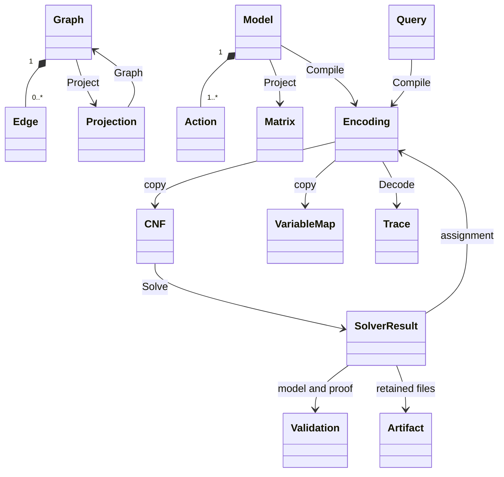
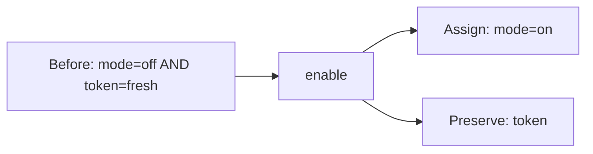

# Data structures

This reference describes the public Go types and the implemented JSON boundary.
Use it to build inputs, interpret results and retain the mappings between them.
[Contracts](contracts.md) covers validation rules, limits and guarantee details;
[graph-to-matrix](graph-to-matrix.md) walks through a complete projection.
The [execution-flow diagrams](execution-flow.md) show when each structure is
created, checked and consumed.

## Overview

The diagram covers the v0 types. The v0.1 `automaton` and `lga` types have
their own sections below. `Graph`/`Projection` refer to `incidence`; `Model`
through `Trace` refer to `finite`; `CNF`/validation/artifacts refer to `sat`. `VariableMap` in the diagram
means `[]finite.Variable`. `SolverResult` means `cadical.Result`.

Matrix array indices and time indices are zero-based. CNF variable IDs are
one-based. IDs such as `a`, `e1` and `enable` are caller-chosen strings, not
array positions.

## Content digests

Source: [digest/digest.go](../digest/digest.go).

`digest.Digest` is a defined string type shared by finite and automaton
encodings, solver configuration, results and retained artifacts. The algorithm and textual parser
live in this package. Current values are SHA-256 encoded as 64 lowercase hex
characters without a prefix. JSON values remain strings.

| API | Return | Responsibility |
| --- | --- | --- |
| `digest.Sum(data)` | `Digest` | Identify the exact supplied bytes |
| `digest.Read(reader)` | `Digest, int64, error` | Hash a stream, report consumed bytes; return no digest on read failure |
| `digest.Parse(text)` | `Digest, error` | Parse the supported textual format |
| `d.String()` | `string` | Return the encoded value |
| `d.Validate()` | `error` | Reject an absent or malformed value |
| `d.Set(text)` | `error` | Parse then assign; implements `flag.Value` and preserves d on failure |

The zero value means absent. `digest.Sum(nil)` is a valid digest of empty content
and differs from that zero value. Direct casts and JSON decoding are unchecked;
acceptance boundaries must validate before trusting the representation. A valid
digest does not establish source truth, model validity or proof verification.

## Graphs and incidence projections

Source: [incidence/incidence.go](../incidence/incidence.go).

Incidence types carry no JSON tags. The "CLI JSON key" columns below name the
keys of the `project` and `reconstruct` input and output, which the CLI
converts to and from these types.

### `incidence.Graph` and `incidence.Edge`

| Go field | CLI JSON key | Go type | Meaning |
| --- | --- | --- | --- |
| `Graph.NodeIDs` | `node_ids` | `[]string` | All included nodes, including isolated nodes |
| `Graph.Edges` | `edges` | `[]Edge` | Independently identified directed edges |
| `Edge.ID` | `id` | `string` | Edge identity; parallel edges have distinct IDs |
| `Edge.From` | `from` | `string` | Source node ID |
| `Edge.To` | `to` | `string` | Target node ID; may equal From |
| `Edge.Relation` | `relation` | `string` | Opaque edge label |

IDs and labels are nonempty UTF-8 strings; node/edge IDs are unique within their
own spaces. Endpoints must name included nodes. Input order need not be sorted.
These types have no payload, snapshot or provenance fields.

### `incidence.Projection`

Let N be the node count and E the edge count.

| Go field | CLI JSON key | Go type / shape | Meaning |
| --- | --- | --- | --- |
| `NodeIDs` | `node_ids` | `[]string`, N | Row index → node ID |
| `EdgeIDs` | `edge_ids` | `[]string`, E | Column index → edge ID |
| `Source` | `source` | `[][]int`, N × E | 1 at each edge's source row |
| `Target` | `target` | `[][]int`, N × E | 1 at each edge's target row |
| `RelationMasks` | `relation_masks` | `map[string][]int`, E cells per label | Relation label → edge-membership row |

Project returns sorted axes and new slices. Graph reconstructs from the supplied
axes, requiring a unique source, target and relation for every edge. A cell is
an integer 0 or 1, not a floating-point weight or a probability.

`incidence.Limits` is a Go configuration type, not a CLI JSON input:

| Field | Unit | Zero selects |
| --- | --- | ---: |
| `MaxNodes` | Nodes | 4,096 |
| `MaxEdges` | Edges | 8,192 |
| `MaxCells` | Cells across both incidence matrices and all relation masks | 4,000,000 |

## Finite models and operation matrices

Sources: [model.go](../finite/model.go), [matrix.go](../finite/matrix.go),
[cnf.go](../finite/cnf.go), [variable.go](../finite/variable.go).

Finite types carry no JSON tags. The "CLI JSON key" columns below name the keys
of the CLI request and response, which the CLI converts to and from these
types. The digest uses the same keys through private types, and its query
also records `profile`, always `finite.Profile`, as the CLI request does; the variable metadata is hand-encoded with the
same keys as `encode.variables`.

### `finite.State`, `finite.Action`, `finite.Model`

`State` is `map[string]string`: field name → categorical value. A complete state
assigns every model field. Guards, goals and forbidden patterns can be partial.

| Go field | CLI JSON key | Go type | Meaning |
| --- | --- | --- | --- |
| `Model.Fields` | `fields` | `map[string][]string` | Field name → allowed categorical values |
| `Model.Forbidden` | `forbidden` | `[]State` | Any matching pattern excludes a complete state |
| `Model.Actions` | `actions` | `[]Action` | Declared transitions |
| `Action.ID` | `id` | `string` | Unique action identity |
| `Action.Guard` | `guard` | `State` | All listed equalities must hold before the action |
| `Action.Effect` | `effect` | `State` | Constant values assigned after the action |
| `Action.Frame` | `frame` | `[]string` | Fields that retain their previous values |

Effect and Frame exactly partition the model fields. Omitted guards impose no
condition; effects cannot be empty. String `"1"` is a category, not integer 1.
The profile does not coerce JSON booleans, numbers or copy expressions to strings.

### `finite.Query` and the encoding budget

| Go field | CLI JSON key | Go type | Meaning |
| --- | --- | --- | --- |
| `Query.Start` | `start` | `State` | Complete domain-valid initial state |
| `Query.Goal` | `goal` | `State` | Nonempty target pattern |
| `Query.Horizon` | `horizon` | `int` | Exact number of actions, including zero |
| `Query.Blocked` | `blocked` | `[][]string` | Complete action sequences to exclude |

`finite.Compile` takes budget options: `WithMaxVariables(n)` (default 100,000)
and `WithMaxClauses(n)` (default 1,000,000). Each `n` must be at least 1;
otherwise Compile returns `finite.ErrInput`. In a CLI request the budget is the
`options` object with `max_variables` and `max_clauses`; a zero or omitted
field keeps the default, and a negative one is an input error.

`finite.Profile` (`categorical-simple-first-hit/v1`) names the semantics that
Compile encodes. Go callers do not pass it; every digest records it, so a later
change of semantics also changes the digest. A CLI query must still carry
`profile` with exactly this value, which the CLI checks before compiling;
any other value returns UNSUPPORTED.

The CLI request is `{model, query, options?}`. Its decoder separately tracks
Horizon presence: omitting it is an error, while explicitly setting 0 requests
zero transitions. Blocked may be omitted; each supplied sequence must have
exactly Horizon actions. `[[]]` blocks the empty sequence when Horizon is 0.

### `finite.Coordinate` and `finite.Matrix`

A Coordinate has `Field string` and `Value string`. The CLI does not output
matrices; `examples/matrix` defines its own JSON form for them.
For F fields, K field/value coordinates and A actions:

| Go field | Go type / shape | Meaning |
| --- | --- | --- |
| `Fields` | `[]string`, F | Frame-column index → field |
| `Coordinates` | `[]Coordinate`, K | Guard/effect-column index → field/value pair |
| `ActionIDs` | `[]string`, A | Row index → action |
| `Guard` | `[][]int`, A × K | 1 means this category is required |
| `Effect` | `[][]int`, A × K | 1 means this category is assigned |
| `Frame` | `[][]int`, A × F | 1 means this field is preserved |

Project sorts fields, values within each field, and action IDs. Matrix.Model
also needs the explicit forbidden patterns; they are not encoded in these three
matrices. Matrix itself is available through the Go API; CLI encode returns CNF
and mappings, not a Matrix field.

For example, let `mode = {off,on}` and `token = {fresh,used}`. Action `enable`
requires `mode=off AND token=fresh`, assigns `mode=on`, and frames `token`:

| Operation row | mode/off | mode/on | token/fresh | token/used |
| --- | ---: | ---: | ---: | ---: |
| Guard[enable] | 1 | 0 | 1 | 0 |
| Effect[enable] | 0 | 1 | 0 | 0 |

| Frame row | mode | token |
| --- | ---: | ---: |
| Frame[enable] | 0 | 1 |

A zero Guard cell means “no requirement here,” not “this value is false.” A
zero Effect cell means “no assignment here,” not “clear this value.” Token stays
unchanged because Frame selects it. Exactly-one category constraints and the
action rules supply the complete transition semantics.

### `finite.Encoding`, `finite.Variable`, `finite.Trace`

Encoding has private fields and is created by Compile. Its public accessors are:

| Method | Return | Meaning |
| --- | --- | --- |
| `CNF()` | `sat.CNF, error` | Independent copy of the compiled formula and metadata |
| `Variables()` | `[]finite.Variable, error` | Copy of the variable-to-model mapping |
| `Digest()` | `digest.Digest, error` | Content digest of the serialized model and query |
| `Decode(assignment)` | `Trace, error` | Check assignment against the owned CNF, then decode |

Each finite Variable has:

| Go field | CLI JSON key | Type | Meaning |
| --- | --- | --- | --- |
| `ID` | `id` | `int` | One-based DIMACS variable ID |
| `Kind` | `kind` | `VariableKind` | StateVariable, ActionVariable or DifferenceVariable |
| `Time` | `time` | `int` | State time or action transition start |
| `OtherTime` | `other_time` | `*int` | Required later state time for different; nil for other kinds |
| `Field` | `field` | `FieldName` | Declared state/difference field; absent for action |
| `Value` | `value` | `Category` | Declared category for state; absent for other kinds |
| `Action` | `action` | `ActionID` | Required declared action for action; absent for other kinds |

`Variable.Validate(model, horizon)` enforces the [role-specific presence and
membership rules](error-handling.md#variable-roles). Action names remain
caller-defined, but a variable must refer to a declared Model action. All
Encoding accessors return an error for nil/uninitialized encodings.

A `different` helper witnesses inequality when true; false alone does not assert
equality. Helpers do not define path identity. The mapping is also serialized as
a JSON string under `sat.Variable.Metadata["finite_variable"]`.

Trace contains `States []State` and `Actions []string`; the CLI writes them as
`states` and `actions`.
`Trace.IsZero()` reports a zero Trace; a decoded trace always has a state.
A trace with H actions contains H+1 complete states. It is a model witness;
original-rule replay and real execution remain separate checks.

## Synchronous Boolean automata (v0.1)

Source: [automaton](../automaton/). The caller implements `automaton.System`;
the other types are plain values.

| Type | Shape | Meaning |
| --- | --- | --- |
| `System` | `Cells() int`, `Bits() int`, `Inputs(cell) []Bit`, `Next(cell, in, out []bool)` | Caller-owned automaton; Calx sees only indices and the rule |
| `Chooser` | `Choices(cell) int` | Optional; choice bits follow the inputs in `in` |
| `Bit` | `Cell`, `Index int` | One state bit of one cell |
| `State` | `[]bool` | `Cells()*Bits()` values; bit (c, i) at index `c*Bits()+i` |
| `Pattern` | `map[Bit]bool` | Partial state constraint |
| `Query` | `Steps int`, `Start`, `Goal Pattern`, `Forbidden []Pattern`, `Violates Quantity` | One exact-length run; nonempty `Violates` requires the quantity to change at some step |
| `Term` | `Bit Bit`, `Weight int` | One signed bit, weight +1 or -1 |
| `Quantity` | `[]Term` | Sum of signed bits, such as mass or one momentum component |
| `Option` | `WithMaxVariables`, `WithMaxClauses`, `WithMaxLiterals` (each `int` ≥ 1) | Encoding budget for `Compile`; omitted options keep the `sat.Limits` defaults |
| `Trajectory` | `States []State`, `Choices [][]bool` | Steps+1 states; per step, every cell's choice bits in cell order; `IsZero()` reports the zero value |

Encoding has private fields and is created by `Compile`:

| Method or function | Return | Meaning |
| --- | --- | --- |
| `CNF()` | `sat.CNF, error` | Independent copy of the compiled formula |
| `Digest()` | `digest.Digest, error` | Content digest of structure, rule tables and query |
| `Decode(assignment)` | `Trajectory, error` | Check assignment against the owned CNF, then decode |
| `Replay(sys, trajectory)` | `error` | Re-evaluate every step; `ErrReplay` on a mismatch |
| `Simulate(sys, start, steps, choose)` | `[]State, error` | Forward run; `choose` supplies choice bits |

Variable IDs are contiguous: state bit (t, c, i) is
`1 + t*Cells*Bits + c*Bits + i` for t = 0..Steps, then choice bit j of cell c
at step t follows all state bits in step-major, cell-major order. For each
step, `Violates` then adds two totalizers, one "changed" variable and the
disagreement variables, and one final clause requires some changed variable to
be true. Decode ignores them. Variables carry no metadata.

## Lattice gases (v0.1)

Source: [lga](../lga/). `lga.HPP{Width, Height, Walls}` is an `automaton.System` with
4 bits per cell in the order `East`, `North`, `West`, `South` (constants 0–3);
north increases y and cell (x, y) has index `y*Width + x`. A state holds the
post-collision particles leaving each cell. One step streams them to the
neighbors and collides there, with periodic boundaries.

| Method | Return | Meaning |
| --- | --- | --- |
| `Mass()` | `automaton.Quantity` | Every particle, weight +1 |
| `MomentumX()`, `MomentumY()` | `automaton.Quantity` | East minus west, north minus south |
| `RowMomentumX(y)`, `ColumnMomentumY(x)` | `automaton.Quantity` | One row's x momentum, one column's y momentum; out of range fails at Compile |
| `Density(states, block)` | `[][]float64, error` | Mean particles per cell for each block×block region, averaged over the states; rows are y |
| `Velocity(states, block)` | `ux, uy [][]float64, error` | Mean momentum per particle for each region; empty regions are zero |

`lga.FHP{Width, Height, Walls}` has 6 bits per cell in the order `HexE`,
`HexNE`, `HexNW`, `HexW`, `HexSW`, `HexSE` (counterclockwise from east). Cell
(q, r) in axial coordinates has index `r*Width + q`. Every fluid cell has one
choice bit. Its quantities are `Mass()`, `MomentumQ()` and `MomentumR()`: the
Cartesian momentum is `Q*(1, 0) + R*(1/2, √3/2)`. `Density` and `Velocity` use
block×block regions of axial indices, and velocity is Cartesian.

Both types take `Walls []bool` (nil, or one entry per cell; true marks a
bounce-back wall) and provide `Validate() error`. Forward simulation uses
`automaton.Simulate(lattice, start, steps, choose)`, or the bit-packed
`HPP.Run(start, steps)` and `FHP.Run(start, steps, choose func(step, cell int) bool)`.
Both `Run` methods return only the final state.

## CNF, assignments and verification records

Sources: [sat/cnf.go](../sat/cnf.go), [sat/result.go](../sat/result.go),
[sat/limits.go](../sat/limits.go), [cadical/runner.go](../sat/cadical/runner.go).

These types carry no JSON tags. The "JSON key" columns below name the keys of
the CLI `solve` input and output; the runner's retained `input.json` and
`outcome.json` use the same keys through private types.

### `sat.CNF` and `sat.Variable`

| Go field | JSON key | Go type | Meaning |
| --- | --- | --- | --- |
| `CNF.Variables` | `variables` | `[]Variable` | Contiguous IDs 1 through N |
| `CNF.Clauses` | `clauses` | `[][]int` | AND of clauses; each clause is an OR of signed literals |
| `CNF.Origins` | `origins` | `[][]string` | Optional clause → contributing consumer IDs |
| `Variable.ID` | `id` | `int` | One-based variable identity |
| `Variable.Metadata` | `metadata` | `map[string]string` | Optional opaque mapping; no logical force |

For `[[1,-2],[2]]`, the formula is `(x1 OR NOT x2) AND x2`.
`clauses: []` is true; `clauses: [[]]` is false. Literal 0 is not a variable:
it terminates a clause only in DIMACS text. If Origins is supplied, it has one
row per clause. Multiple origin IDs do not implicitly create AND constraints.

An assignment is `map[int]bool` in Go, or an object such as
`{"1":true,"2":false}` in JSON. SAT checking requires every declared variable
exactly once, including false values and variables absent from all clauses.

### `sat.Result` and `cadical.Result`

| Go field | JSON key | Go type | Meaning |
| --- | --- | --- | --- |
| `Status` | `status` | `sat.Status` | Backend answer: SAT, UNSAT or UNKNOWN |
| `InputDigest` | `input_digest` | `digest.Digest` | Exact generated input.json identity |
| `FormulaDigest` | `formula_digest` | `digest.Digest` | Exact generated input.cnf identity |
| `SolverDigest` | `solver_digest` | `digest.Digest` | Pinned solver executable identity |
| `CheckerDigest` | `checker_digest` | `digest.Digest` | Pinned proof-checker identity |
| `Model` | `model` | `Validation` | Assignment availability, decoding and checking |
| `Proof` | `proof` | `Validation` | Proof availability and checking |
| `Artifacts` | `artifacts` | `[]Artifact` | Retained per-query file identities |
| `cadical.Result.Assignment` | `assignment` | `map[int]bool` | Decoded total SAT assignment, when available |

`cadical.Result` embeds `sat.Result`; in CLI output `assignment` appears at the
same level as the other result fields.
`sat.Result.IsZero()` and `sat.Validation.IsZero()` report the zero value.
`cadical.Result.IsZero()` also requires no assignment. A runner never returns
a zero Result, even on error, so IsZero separates an unset Result from an
UNKNOWN answer.
A result can retain SAT/UNSAT even when Solve returns an error. The error is a
separate Go return value, not a field in sat.Result.

### `sat.Validation`, `sat.Artifact`, `sat.Requirements`

| Go field | JSON key | Type | Meaning |
| --- | --- | --- | --- |
| `Validation.Present` | `present` | `bool` | Model/proof was available |
| `Validation.Decoded` | `decoded` | `bool` | Model was decoded; not a proof-syntax verdict |
| `Validation.Checked` | `checked` | `bool` | The reported check completed successfully |
| `Validation.Method` | `method` | `string` | Check method, set after success |
| `Validation.TargetDigest` | `target_digest` | `digest.Digest` | Model targets InputDigest; proof targets FormulaDigest |
| `Artifact.ID` | `id` | `string` | File identity relative to the runner's artifact root |
| `Artifact.Digest` | `digest` | `digest.Digest` | Digest of exact file bytes |
| `Artifact.Bytes` | `bytes` | `int64` | File size |

Requirements is a Go acceptance-policy type with `SATModelChecked bool` and
`UNSATProofChecked bool`. Set the checks a consumer requires and call Require
only after checking the Solve error. A deserialized `checked:true` field is not
proof that the receiving process performed a check.

### Execution configuration

These are Go API configuration fields, not additional CLI JSON request fields.

| `sat.Limits` field | Type | Zero selects |
| --- | --- | --- |
| `Timeout` | `time.Duration` | 30 seconds shared by solver/checker |
| `MaxVariables` | `int` | 100,000 |
| `MaxClauses` | `int` | 1,000,000 |
| `MaxLiterals` | `int` | 4,000,000 |
| `MaxInputBytes` | `int` | 16 MiB |
| `MaxOutputBytes` | `int64` | 16 MiB per process stream |

| `cadical.Config` field | Type | Purpose |
| --- | --- | --- |
| `SolverPath`, `SolverDigest` | `string`, `digest.Digest` | Solver executable file path and expected content digest |
| `CheckerPath`, `CheckerDigest` | `string`, `digest.Digest` | Checker executable file path and expected content digest |
| `ArtifactDir` | `string` | New directory for private tool copies and query outputs |
| `Limits` | `sat.Limits` | Per-query budgets |
| `MaxProofBytes` | `int64` | Accepted proof size; zero selects 64 MiB |

Both executable paths and digests are required. `New` validates typed digest
values before using them, including values constructed by a direct cast.
`ArtifactDir` must not exist and its parent must already exist.

Runner owns private configuration and tool copies. `New` constructs it; `Solve`
returns `cadical.Result, error`; `Identity` returns `(digest.Digest, error)` for effective tools/limits;
`ReadArtifact` verifies retained bytes against an Artifact. Callers own retention.

## CLI request and response structures

The implemented wire format is JSON, plus DIMACS for solve input. There are
currently no generated Protobuf types. Go configuration objects above are not
implicitly accepted as request schemas.

| Command | Input | Successful `data` value |
| --- | --- | --- |
| `project` | `{node_ids,edges}` | `{node_ids,edge_ids,source,target,relation_masks}` |
| `reconstruct` | `{node_ids,edge_ids,source,target,relation_masks}` | `{node_ids,edges}` |
| `encode` | `{model,query,options?}` | `{query_digest,cnf,variables,dimacs}` |
| `decode` | `{request:{model,query,options?},assignment}` | `{states,actions}` |
| `solve` | `{variables,clauses,origins?}`, or DIMACS with `--format dimacs` | `{result}` |
| `solve-finite` | `{model,query,options?}` | `{result,query_digest,trace?}` |
| `pin-tools` | none; flags only | the written `calx-tools/v1` manifest |

`encode.variables` is `[]finite.Variable`, while `encode.cnf.variables` is
`[]sat.Variable`. `trace` is present only after successful SAT decoding.
`query_digest` binds the finite model/query; it differs from the formula digest.

Every response is wrapped in this envelope:

| JSON key | Type | Meaning |
| --- | --- | --- |
| `schema_version` | string | `calx-cli/v2` |
| `outcome` | string | OK or ERROR for this command |
| `input_digest` | string (Go: `digest.Digest`) | Exact original transport bytes, before JSON/DIMACS decoding; omitted by `pin-tools`, which reads no input. If the input cannot be read it is the digest of the bytes read, which for a missing `--in` file is the empty input's digest, and for an oversized input its first 16 MiB + 1 bytes |
| `data` | object, optional | Command output or retained diagnostic result |
| `error` | object, optional | `{code:string,message:string}` |

Error codes are CANCELED, TIMEOUT, LIMIT, UNSUPPORTED, INCONCLUSIVE, GUARANTEE,
PROTOCOL, VALIDATION, or INPUT_OR_EXECUTION. Go Solve errors are carried here separately
from `data.result.status`. Exit 0 means the command met its checks; exit 1 is
failure; exit 2 is flag/usage failure, including an unreadable `--tools`
manifest, which prints usage/error text to stderr rather than a JSON envelope.
`--help` prints usage to stderr and exits 0. Project/encode OK does not mean SAT was run.
An explicit UNKNOWN produces exit 1, outcome ERROR and code INCONCLUSIVE while
retaining `data.result.status: UNKNOWN` and the diagnostic artifact inventory.
Joined cancellation/deadline errors produce CANCELED/TIMEOUT instead.
When `incidence.Project`, `Projection.Graph` or `Encoding.Decode` fails,
`project`, `reconstruct` or `decode` still return `data` with an empty value of
the usual shape: `[]` for every array and `{}` for `relation_masks`, never
null. Earlier failures (malformed JSON, a missing required field, or a decode
request that does not compile) omit `data`. `decode` has no required fields: a
missing `assignment` is an empty one, which `Encoding.Decode` rejects as not
total, so it returns the empty trace.

CLI JSON uses exact field names and rejects duplicate/unknown fields, null and
trailing values. Native Go nil slices/maps may be usable zero values; direct
encoding/json output can contain null and is not automatically a valid CLI
request. Use explicit empty arrays/objects where appropriate. See
[contracts](contracts.md#json-cli) for the full parsing boundary.
