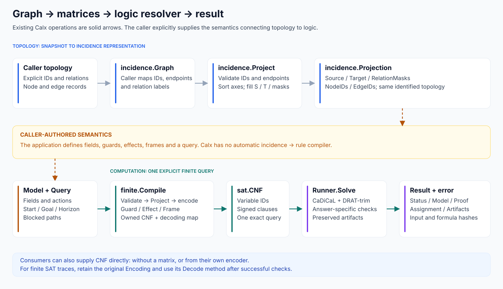
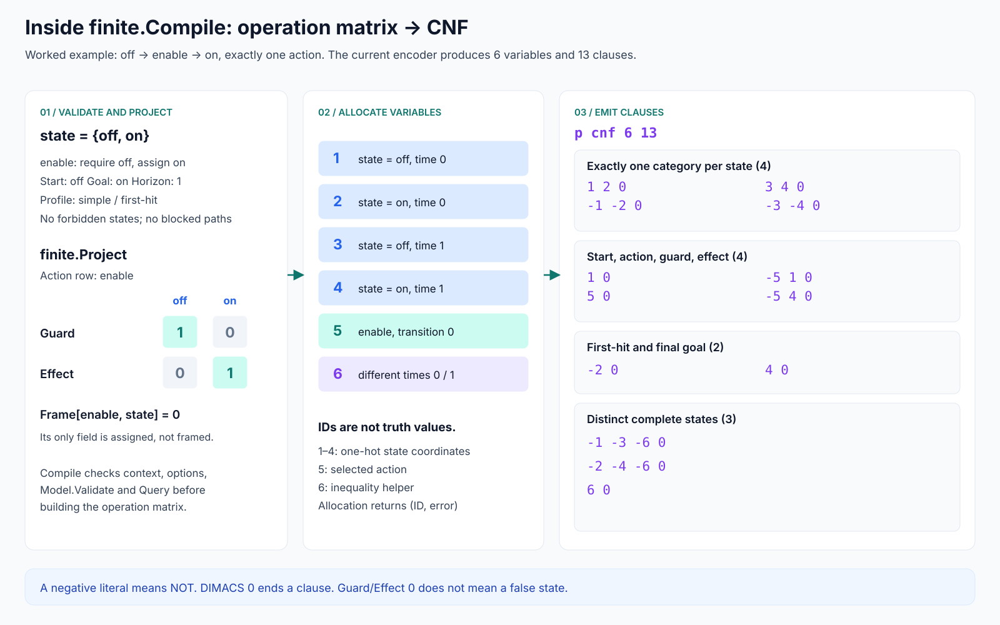
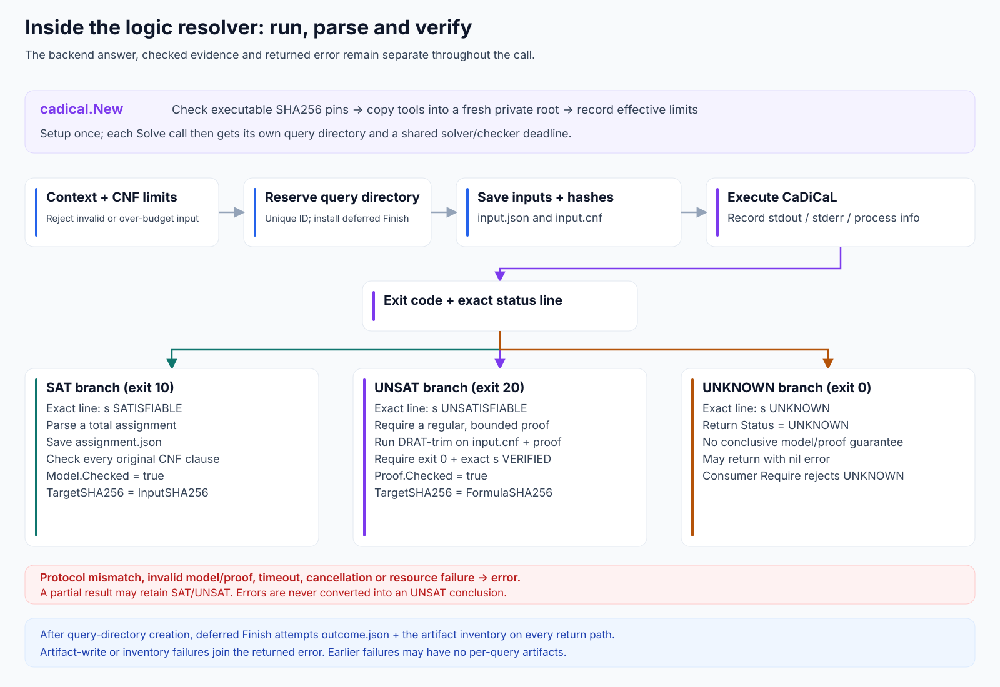
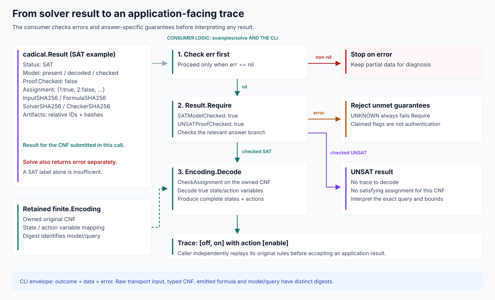
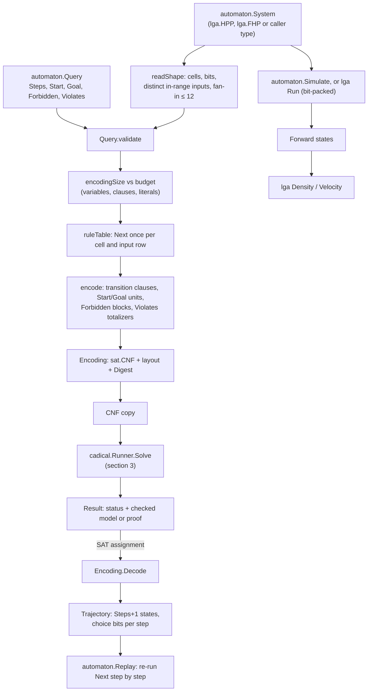

# Internal execution: graph → matrix → logic resolver → result

Sections 1–4 follow the v0 finite route. Section 5 follows the v0.1 automaton
and lattice-gas route, which reuses the same solver and checks. Start with the
overview, then follow the matrix compiler, solver/checker and result-decoding
paths.
The worked computation is the README example: one action changes `state=off`
to `state=on`, with an exact horizon of one.

| Diagram | What it explains |
| --- | --- |
| [1. Complete flow](#1-complete-flow) | Explicit topology, matrix representations, caller rules and Calx entry points |
| [2. Matrix to CNF](#2-operation-matrix-to-cnf) | Validation, time-indexed variables and the actual emitted clauses |
| [3. Resolver internals](#3-logic-resolver-internals) | Pinned tools, execution, SAT/UNSAT/UNKNOWN branches and retained artifacts |
| [4. Result to trace](#4-result-to-trace) | Error handling, answer-specific guarantees and decoding with the original Encoding |
| [5. Automata and lattice gases](#5-automata-and-lattice-gases) | `automaton.System` to CNF, conserved-quantity queries, replay, and forward simulation with `lga` |

## 1. Complete flow



The topology route begins with caller-supplied node IDs and edges in an
`incidence.Graph`, including explicit endpoints and relation labels.
The [JSON example](../examples/graph.json) supplies this input to the CLI's
`project` command. `incidence.Project` validates and sorts the topology, then
creates S, T, the row/column IDs and relation masks. The detailed cell-by-cell
example is in [graph-to-matrix](graph-to-matrix.md).

The orange step is application code, not a Calx API. The application declares
what its fields and actions mean. There is no built-in conversion from an
incidence matrix to guards, effects or logical propositions. Applications can
supply a finite model directly, or produce their own CNF and enter at the solver.

The two matrix contracts have different axes:

| Representation | Rows | Columns | Cell meaning |
| --- | --- | --- | --- |
| `incidence.Projection.Source` / `Target` | Nodes | Identified edges | This node starts/ends this edge |
| `finite.Matrix.Guard` / `Effect` | Actions | Field/value coordinates | This action requires/assigns this value |
| `finite.Matrix.Frame` | Actions | Fields | This action preserves this field |

**Source:** [incidence.Project](../incidence/incidence.go),
[finite.Compile](../finite/cnf.go), [finite.Project](../finite/matrix.go),
[Runner.Solve](../sat/cadical/runner.go).

## 2. Operation matrix to CNF



### Validation and allocation

Compile first checks the context, options, model and query. This catches invalid
field/value references, incomplete effect/frame partitions and invalid query
bounds before solving. Project establishes stable field/value
coordinates and action rows. Each allocation and clause-building step returns
errors directly. The compiler does not hide failures in a sentinel ID or delayed
error field. The encoder estimates variable/clause budgets before allocating
time-indexed arrays.

For the example, sorted coordinates are `[state/off, state/on]` and the single
action is `enable`. Guard is `[1,0]`, Effect is `[0,1]`, and Frame is `[0]`.
A zero Guard/Effect cell adds no requirement/assignment. The only field is
assigned here, so no frame-preservation clauses are emitted in this example.

The current implementation allocates the following one-based variable IDs:

| ID | `finite.Variable` meaning |
| ---: | --- |
| 1 | `state=off` at time 0 |
| 2 | `state=on` at time 0 |
| 3 | `state=off` at time 1 |
| 4 | `state=on` at time 1 |
| 5 | Action `enable` at transition 0 |
| 6 | `different` witness for field `state` between times 0 and 1 |

These IDs identify Boolean variables; they are not yet assignments.
The different helper is not an equivalence test: false alone does not establish
that the states are equal. Here the final unit clause forces the witness true.

### Emitted formula

The complete DIMACS output for the current example is:

```text
p cnf 6 13
1 2 0
-1 -2 0
3 4 0
-3 -4 0
1 0
5 0
-5 1 0
-5 4 0
-2 0
4 0
-1 -3 -6 0
-2 -4 -6 0
6 0
```

| Clause group | What it enforces |
| --- | --- |
| `1 2`; `-1 -2`; `3 4`; `-3 -4` | Exactly one category at each state time |
| `1` | Initial state is off |
| `5` | The only action is selected for the one transition |
| `-5 1` | Selecting enable requires off before the action |
| `-5 4` | Selecting enable assigns on after the action |
| `-2`; `4` | Goal is not reached at time 0 and is reached at time 1 |
| `-1 -3 -6`; `-2 -4 -6`; `6` | The two complete states must differ |

Rows in the table omit the DIMACS `0` terminator. A negative literal means
logical negation; literals within one clause are OR, and all clauses are AND.

For models with framed fields, selecting an action also implies equality of
each framed field's before/after one-hot values. Forbidden patterns, blocked
action sequences, other fields and larger horizons add their own clauses.
They are not silently omitted when present in a request. Changing any of these
inputs can change the meaning of UNSAT.

The Encoding retains the private formula, operation matrix, state/action ID
arrays and variable mapping. `CNF()` returns a copy plus error for solving;
`Variables()` returns the validated finite-variable mapping plus error. The digest returned
by `Digest()` also has an error result and identifies the serialized
model/query separately from the formula's byte digest.

**Source:** [Model and query validation](../finite/model.go),
[matrix construction](../finite/matrix.go), [explicit encoding stages, variable, one and add](../finite/compiler.go).

## 3. Logic resolver internals



`cadical.New` verifies executable pins and creates private copies in a fresh
artifact root. For each Solve call, the runner:

1. Sets UNKNOWN initially, creates one deadline and validates context/CNF limits.
2. Reserves a new query directory and registers deferred artifact finalization.
3. Saves typed `input.json` and encoded `input.cnf`, retaining each exact digest.
4. Runs the pinned CaDiCaL executable with bounded stdout/stderr capture.
5. Requires a consistent exit code and exact status line, then checks the
   answer-specific evidence.

The recognized backend responses are:

| Branch | Required status/exit pair | Additional check |
| --- | --- | --- |
| SAT | Exit 10 and exact `s SATISFIABLE` | Decode a total assignment, save it, and check every original input clause |
| UNSAT | Exit 20 and exact `s UNSATISFIABLE` | Require a regular proof within the accepted-size limit; run pinned DRAT-trim on the encoded CNF and proof |
| UNKNOWN | Exit 0 and exact `s UNKNOWN` | Return `sat.ErrInconclusive`; retain UNKNOWN and diagnostic artifacts |

The solver output must not contain a contradictory status line. The UNSAT
checker must emit exact `s VERIFIED`, must not emit `s NOT VERIFIED`, and must
exit zero. The one exception is a formula that already contains an empty
clause: DRAT-trim then reports `c trivial UNSAT` and exits 1, which is accepted
with the method `drat-trim/trivial-unsat-empty-clause`.
The proof-size limit is checked after solver execution; it is not a disk quota.

A check failure, process failure, cancellation, deadline or resource failure
returns an error. If the backend had already answered SAT/UNSAT, that label can
remain in the partial Result. The caller must inspect error separately. An
explicit UNKNOWN is a recognized response that returns `sat.ErrInconclusive`;
it never returns success merely because its exit/status pair is valid.
If context cancellation or a deadline is also observed, its error is retained
with `errors.Join`. CLI codes CANCELED and TIMEOUT take precedence over INCONCLUSIVE.

Once the query directory exists, deferred Finish attempts to write outcome.json
and an inventory of retained files on both successful and failed paths. A file
write or inventory failure can itself join the returned error. Earlier failures
may have no per-query artifact directory.

| Retained item | Role |
| --- | --- |
| Root `tools.json`, `limits.json`, private executables | Tool pins and effective configuration |
| `input.json`, `input.cnf` | Typed input and the exact formula submitted to the solver |
| `solver.stdout`, `.stderr`, `.json` | Solver output and process/deadline record |
| `assignment.json` when decoded | The assignment checked against the typed CNF |
| `proof.drat`, `checker.*` when produced | UNSAT proof and checker execution evidence |
| `outcome.json` and returned Artifact inventory | Partial/final outcome plus file sizes and digests |

The inventory contains outcome.json, but outcome.json omits its own inventory
so it does not recursively hash itself. CLI `request.input` is a separate
root-level copy of the original transport input.

**Source:** [Runner.New/Solve](../sat/cadical/runner.go),
[tool execution](../internal/toolrun/process.go),
[query setup and Finish](../internal/toolrun/workspace.go),
[assignment checking](../sat/cnf.go).

## 4. Result to trace



This diagram starts with the Result from the CNF submitted in the same call.
The consumer first checks `err`, then invokes Require with its acceptance policy.
Setting both requirement flags to true means “check the relevant answer branch”:

- SAT needs its present, decoded, checked model bound to InputDigest.
- UNSAT needs its present, checked proof bound to FormulaDigest.
- UNKNOWN returns `sat.ErrInconclusive` from Require.

SAT does not need `Proof.Checked=true`; the SAT example correctly has it false.
Likewise, UNSAT does not provide a satisfying assignment to decode.

For the six-variable example, the checked assignment is:

```json
{"1":true,"2":false,"3":false,"4":true,"5":true,"6":true}
```

Decode first checks this complete assignment against its own retained CNF. It
then uses its time/coordinate arrays to produce:

```json
{
  "states": [{"state":"off"},{"state":"on"}],
  "actions": ["enable"]
}
```

The different helper contributes to formula validation but not to the action
sequence. Independent replay of the consumer's original rules is a later
consumer responsibility; Decode itself does not perform that independent check.

Require does not authenticate arbitrary received/cached results or establish
that a result belongs to another query. Consumers exchanging results must retain
and check the intended input identities and trust boundary. A previously checked
H0 UNSAT result cannot be reused as the result of this H1 query merely because
Require accepts that old result's own fields.

### Keep these identities separate

| Identity | What it identifies |
| --- | --- |
| `Encoding.Digest()` | Compact Go JSON of the finite model and query |
| `Result.InputDigest` | Exact generated typed CNF input.json |
| `Result.FormulaDigest` | Exact generated DIMACS input.cnf |
| CLI envelope `input_digest` | Original transport input bytes before decoding |

These hashes identify different representations; equality is not expected.
The CLI packages command outcome, data and error separately. For solve-finite,
its data can contain the result, model/query digest and a successfully decoded
SAT trace. Complete fields are in [data structures](data-structures.md).

**Source:** [Result.Require](../sat/result.go), [Encoding.Decode](../finite/cnf.go),
[standalone example](../examples/solve/main.go), [CLI envelope](../internal/cli/cli.go).

## 5. Automata and lattice gases

The v0.1 route starts from a caller-supplied `automaton.System` instead of a
finite model. `lga.HPP` and `lga.FHP` are such systems, but any type that
implements the four methods works. The solver stage (section 3) and the
answer-specific checks (section 4) are the same as for the finite route.



**Validation and budget.** `Compile` checks the context and budget options, reads each
cell's inputs and choice count once, and validates the query patterns and
`Violates` terms. It then predicts the exact variable, clause and literal
counts and fails with `sat.ErrLimit` before calling `Next` if any exceeds the
budget.

**Rule tables and clauses.** For each cell, `Next` is evaluated once for every
assignment of its inputs and choice bits, and the table is reused for every
step. Each (step, cell, output bit, table row) yields one clause: if the inputs
equal that row, the output bit at the next time equals the table value. Start
and Goal become unit clauses at time 0 and time `Steps`. Each Forbidden pattern
becomes one blocking clause per time.

**Variable layout.** State bit (t, c, i) is variable
`1 + t*Cells*Bits + c*Bits + i` for t = 0..Steps. Choice bits follow, step by
step and cell by cell. Totalizer and disagreement variables for `Violates` come
last; `Decode` ignores them.

**Conserved quantities.** A `Violates` quantity Q = P − N compares, for each
step t, `P(t−1) + N(t)` with `P(t) + N(t−1)` through two exact totalizer
counters. Each comparison has a variable that, when true, requires the counts
to differ, and one clause requires some step's variable to be true. UNSAT
therefore proves Q has the same value at every time of every run of this
system, including runs that would change it and change it back.

Worked sizes, matching `Compile`:

| System and query | State and choice variables | Auxiliary variables | Clauses |
| --- | ---: | ---: | ---: |
| Rule 90, 4 cells, 2 steps, Start and Goal (the package example) | 12 | 0 | 64 transition + 8 units = 72 |
| HPP 2×2, 3 steps, `Violates: Mass()` (16 terms) | 64 | 435 | 768 transition + 3 × 769 counter + 1 = 3,076 |

**Result to trajectory.** After a checked SAT answer, `Decode` checks the total
assignment against the owned CNF and returns `Steps+1` states plus each step's
choice bits. `Replay` re-evaluates `Next` on that trajectory. It shares the rule
source, so it checks the encoding, not whether the rule models anything
physical. An UNSAT answer has no trajectory, and its claim is limited to the
declared system, step count and patterns.

**Forward simulation.** `automaton.Simulate` runs any System cell by cell.
`lga.HPP.Run` and `lga.FHP.Run` produce the same final state with a bit-packed
path: one plane per direction, 64 cells per word, streaming by
row shifts and collisions by bitwise logic. `Density` and `Velocity` average
the resulting states over blocks.

**Source:** [automaton.Compile](../automaton/compile.go),
[totalizer and Violates](../automaton/quantity.go),
[Simulate and Replay](../automaton/automaton.go), [lga HPP](../lga/hpp.go),
[lga FHP](../lga/fhp.go), [bit-packed Run](../lga/packed.go).

## Reproduce the non-solver stages

From the repository root:

```sh
go run ./cmd/calx project --in examples/graph.json
go run ./examples/compile
go run ./cmd/calx encode --in examples/finite.json
```

The first prints the graph projection. The second prints the complete CNF above.
The third also includes the finite variable map and model/query digest. See the
[README solve example](../README.md#4-satcadical-solve-check-and-decode) for checked SAT and
UNSAT executions with explicitly pinned local tools.

For the automaton route, `go run ./examples/lga` runs a forward simulation and
`go test -run ExampleCompile ./automaton` checks the 72-clause example above.
