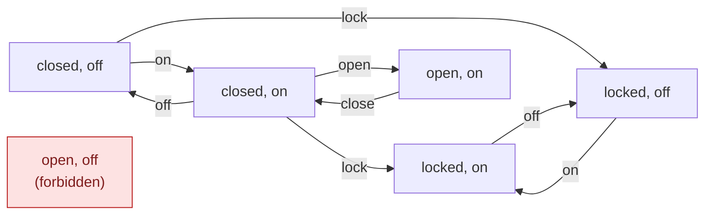
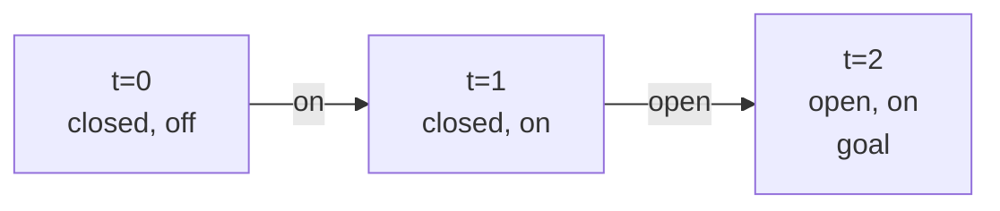
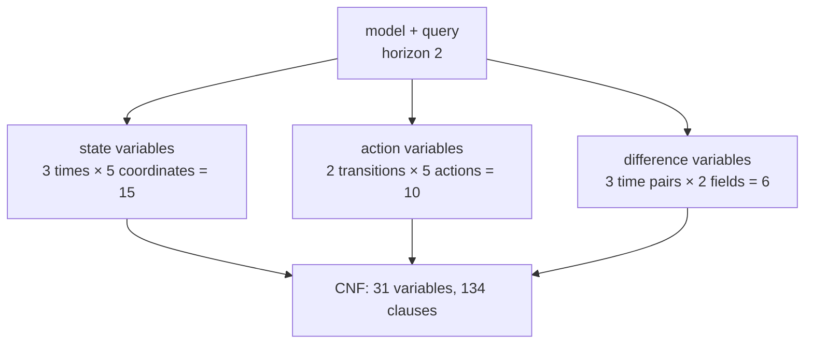

# Finite model primer

This page explains, with pictures, what the `finite` package does. It uses one
small model throughout: a door and a light. Every transition, matrix, variable
count and answer below was produced by running Calx, with the pinned CaDiCaL
and DRAT-trim for the answers, not worked out by hand.
[`finite/primer_test.go`](../finite/primer_test.go) checks them all with a
small exhaustive search instead of a solver.

For the exact rules see [contracts](contracts.md#finite-categorical-profile);
for a clause-by-clause walk through a one-field model see
[execution flow](execution-flow.md#2-operation-matrix-to-cnf).

## 1. Fields, values and states

A finite model describes a system with a few named **fields**, each taking one
of a fixed set of **values**. Values are plain labels; Calx never treats `"1"`
as a number.

| Field | Values |
| --- | --- |
| door | closed, locked, open |
| light | off, on |

A **state** gives every field one value, so this model has 3 × 2 = 6 states. A
**forbidden** pattern removes states: here the door may not be open while the
light is off, which leaves 5 allowed states.

## 2. Actions: guard, effect, frame

An **action** changes the state in one step:

- its **guard** must hold before the action;
- its **effect** sets fields to constant values;
- its **frame** lists the fields that keep their value.

Effect and frame together name every field exactly once, so nothing changes by
accident.

| Action | Guard | Effect | Frame |
| --- | --- | --- | --- |
| open | door=closed | door=open | light |
| close | door=open | door=closed | light |
| lock | door=closed | door=locked | light |
| on | light=off | light=on | door |
| off | light=on | light=off | door |

There is no unlock action. Asking Calx for every one-step move between two
allowed states gives this graph:



`open` from closed/off is missing because it would reach the forbidden state,
and `off` from open/on is missing for the same reason. Once the door is locked
it stays locked.

## 3. The matrix view

`finite.Project` writes the actions as 0/1 matrices. The columns are the
sorted field/value pairs (**coordinates**), and the rows are the sorted
actions:

| Guard | door=closed | door=locked | door=open | light=off | light=on |
| --- | :---: | :---: | :---: | :---: | :---: |
| close | 0 | 0 | 1 | 0 | 0 |
| lock | 1 | 0 | 0 | 0 | 0 |
| off | 0 | 0 | 0 | 0 | 1 |
| on | 0 | 0 | 0 | 1 | 0 |
| open | 1 | 0 | 0 | 0 | 0 |

The Effect matrix has the same shape, with a 1 at each value an action sets.
The Frame matrix has one column per field:

| Frame | door | light |
| --- | :---: | :---: |
| close | 0 | 1 |
| lock | 0 | 1 |
| off | 1 | 0 |
| on | 1 | 0 |
| open | 0 | 1 |

`Matrix.Model` turns the matrices back into the same actions, sorted by ID, so
the matrix is a faithful second view of the model. Forbidden patterns are not
in the matrices; the caller passes them back separately.

## 4. Asking a question

A `finite.Query` asks: **from Start, is there a run of exactly Horizon actions
that ends in Goal?** Goal may name only some fields. The answer follows three
rules:

| Rule | Meaning |
| --- | --- |
| Exact length | The run has exactly Horizon actions, no fewer |
| Simple | No state repeats along the run |
| First hit | The goal is not reached before the last step |

From closed/off, Calx answered "can the door be open?" for each horizon:

| Horizon | Answer | Run |
| ---: | --- | --- |
| 0 | UNSAT | |
| 1 | UNSAT | |
| 2 | SAT | on, open |
| 3 | UNSAT | |
| 4 | UNSAT | |
| 5 | UNSAT | |



**Why horizon 1 fails:** `open` from closed/off would reach the forbidden
state. **Why horizon 3 and more fail:** the only way to open the door is from
closed/on, and the run can be at closed/on only at time 1. Getting back there
later would repeat a state, and locking the door is a dead end. So UNSAT at
horizon 3 means "no simple first-hit run of exactly 3 actions", not "the door
can never open".

First hit changes answers too. For the goal door=locked:

| Horizon | Answer | Run |
| ---: | --- | --- |
| 1 | SAT | lock |
| 2 | SAT | on, lock |
| 3 | UNSAT | |

At horizon 2, lock then on is not allowed, because the door is already locked
after one step.

**Blocked** sequences exclude whole runs. Blocking `[on, open]` at horizon 2
removes the only run, and the answer becomes UNSAT. That UNSAT is about the
blocked question; it does not say the unblocked question has no answer.

## 5. From a question to CNF

`finite.Compile` turns the model and query into a [CNF formula](sat-primer.md).
It creates one variable for each fact that could be true:



The first variables for this query are:

| ID | Meaning |
| ---: | --- |
| 1–5 | time 0: door=closed, door=locked, door=open, light=off, light=on |
| 6–10 | time 1: the same five coordinates |
| 11–15 | time 2: the same five coordinates |
| 16–20 | transition 0: close, lock, off, on, open |
| 21–25 | transition 1: close, lock, off, on, open |
| 26–31 | "differs" witnesses for door and light between times 0–1, 0–2 and 1–2 |

The clauses then say:

- each field has exactly one value at each time, and forbidden states are out;
- exactly one action happens at each transition;
- a chosen action implies its guard before, its effect after, and an unchanged
  frame;
- the start holds at time 0, the goal holds at the last time and not earlier;
- every two times differ in at least one field, which makes the run simple;
- every blocked sequence is excluded.

`Encoding.Variables` returns this mapping, and `Encoding.CNF` the formula.
Before compiling, Calx checks the encoding budget (`WithMaxVariables`,
`WithMaxClauses`); a request over budget is an error, never UNSAT.

## 6. Back from the solver

A SAT answer is an assignment to all 31 variables. `Encoding.Decode` checks it
against the formula and reads the run back out of the state and action
variables:

```json
{
  "states": [
    {"door": "closed", "light": "off"},
    {"door": "closed", "light": "on"},
    {"door": "open", "light": "on"}
  ],
  "actions": ["on", "open"]
}
```

An UNSAT answer comes with a checked proof and has no run. Either way, the
answer is about the model as written. Whether the model describes the real
door and light is up to its author.

`Encoding.Digest` identifies the model and query. It also records
`finite.Profile` (`categorical-simple-first-hit/v1`), the name of the three
rules in section 4, so a future change of rules would change the digest.
