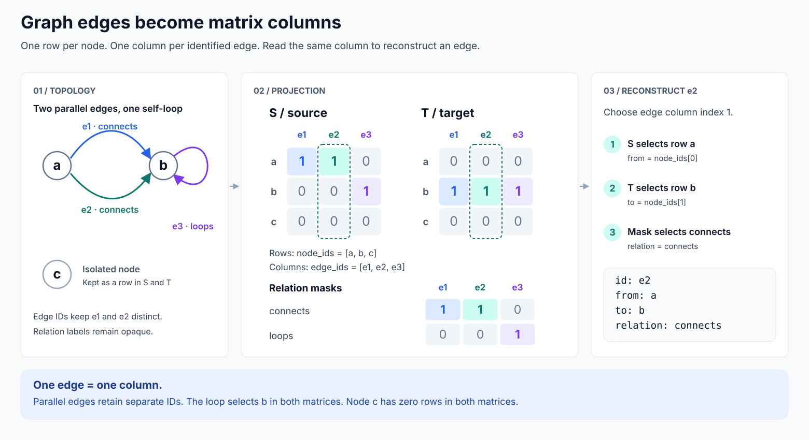
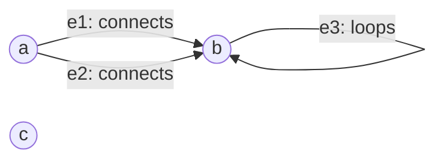
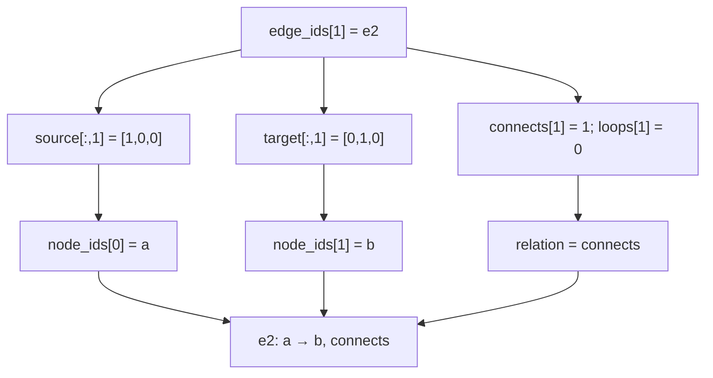
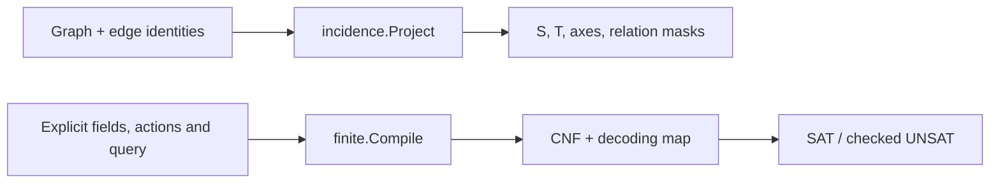

# How a graph maps to matrices

Calx gives every node a row and every independently identified edge a column.
Two binary matrices record where each edge starts and ends. A relation mask
records its label. Together with the row and column IDs, these values let Calx
reconstruct the graph's topology.



## 1. Start with an explicit graph

The [input example](examples/graph.json) contains three nodes and three edges:



| Edge ID | From | To | Relation |
| --- | --- | --- | --- |
| `e1` | `a` | `b` | `connects` |
| `e2` | `a` | `b` | `connects` |
| `e3` | `b` | `b` | `loops` |

`e1` and `e2` are distinct edges even though their endpoints and labels match.
`e3` is a self-loop. Node `c` belongs to this graph but has no incident edge.
The labels `connects` and `loops` are opaque strings; Calx assigns no logical
or application meaning to them.

## 2. Assign stable row and column indices

`incidence.Project` copies and sorts node IDs and edge IDs lexicographically.
The example deliberately supplies nodes as `[c,a,b]` and edges as `[e3,e2,e1]`;
its projection uses:

| Index | `node_ids[index]` — matrix row | `edge_ids[index]` — matrix column |
| --- | --- | --- |
| 0 | `a` | `e1` |
| 1 | `b` | `e2` |
| 2 | `c` | `e3` |

Node and edge indices are separate spaces. The example happens to have three
of each; a graph with N nodes and E edges has N × E incidence matrices.
The array index is zero-based. It is distinct from the one-based variable IDs
used later by SAT.

## 3. Fill the source and target matrices

For edge column `j`:

- Set `source[i][j] = 1` exactly at the row of that edge's `from` node.
- Set `target[i][j] = 1` exactly at the row of that edge's `to` node.
- Leave all other cells in that column at zero.

**Source matrix S** — which node starts each edge:

| Node row | e1 | e2 | e3 |
| --- | ---: | ---: | ---: |
| a | 1 | 1 | 0 |
| b | 0 | 0 | 1 |
| c | 0 | 0 | 0 |

**Target matrix T** — which node ends each edge:

| Node row | e1 | e2 | e3 |
| --- | ---: | ---: | ---: |
| a | 0 | 0 | 0 |
| b | 1 | 1 | 1 |
| c | 0 | 0 | 0 |

Each column has exactly one 1 in S and exactly one 1 in T. These positions can
be on the same row: both matrices have a 1 at `(b,e3)`, preserving the self-loop.
Node `c` has a zero row in **both** matrices, preserving its isolated presence.
A zero row in only S or only T does not establish isolation: a node may have
only incoming or only outgoing edges.

## 4. Keep relation labels aligned with the same edge columns

`relation_masks` maps each observed relation label to an E-element binary row:

| Relation | e1 | e2 | e3 |
| --- | ---: | ---: | ---: |
| connects | 1 | 1 | 0 |
| loops | 0 | 0 | 1 |

Every edge column selects exactly one relation. The complete
[projection JSON](examples/projection.json) therefore carries five pieces:
`node_ids`, `edge_ids`, `source`, `target`, and `relation_masks`.
The numeric matrices alone do not identify the nodes, edges or relation labels.

## 5. Reconstruct an edge by reading one column

For `e2`, choose column index 1:



`Projection.Graph` does this for every column. It rejects duplicate/empty IDs,
wrong dimensions, nonbinary cells, missing endpoints, multiple selected
endpoints, and missing or multiple selected relations. All node IDs are retained,
including those with zero rows in both matrices.

The reconstructed graph has the same identified topology as the input. Its
ordering may differ from the original input ordering because Project sorted
the axes. This is a topology round trip, not an original-JSON-byte round trip.

## Why keep two matrices and the edge IDs?

An ordinary Boolean adjacency matrix answers whether at least one edge connects
a pair of nodes. It merges the two `a → b` edges into one occupied cell, losing
their separate identities. S and T retain one column for each edge.

A signed incidence matrix formed as `T - S` has an all-zero column for a
self-loop. Keeping S and T separately preserves both endpoints of `e3`.
These are explanations of the representation; Calx does not currently expose
an adjacency or signed-incidence calculation API.

## What remains beside the projection?

| Preserved by this Calx structure | Retained by the caller |
| --- | --- |
| Node IDs, edge IDs, directed endpoints, relation labels | Payloads, provenance, derivation manifests, timestamps |
| Isolated nodes, parallel edges and self-loops | Source bytes/hash, snapshot identity, scope and truncation |

The caller retains sidecars using the same node/edge IDs and reattaches them
when needed. An isolated node or missing edge describes the supplied graph,
not the completeness of an external evidence store.

## Where does SAT enter?

Continue with the [internal execution diagrams](execution-flow.md) for the
operation-matrix compiler, resolver branches and result-to-trace path.

The graph projection is one computational entry point. An explicit transition
model is another:



There is no automatic arrow from the incidence matrices to a finite action
model. The application supplies the meaning of its rules. `finite.Matrix`
encodes Guard/Effect/Frame using different axes; see the
[data-structure reference](data-structures.md#finite-models-and-operation-matrices).

## Run this example

From the repository root, after building `bin/calx`:

```sh
mkdir -p artifacts
bin/calx project --in docs/examples/graph.json
bin/calx reconstruct --in docs/examples/projection.json
```

The second command uses the matching projection fixture. For a dynamically
produced projection, pass the first response's `data` object to reconstruct,
not the whole envelope. The expected data object is
[docs/examples/projection.json](examples/projection.json).

Implementation: [Project and Graph](../incidence/incidence.go).
