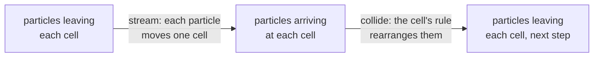
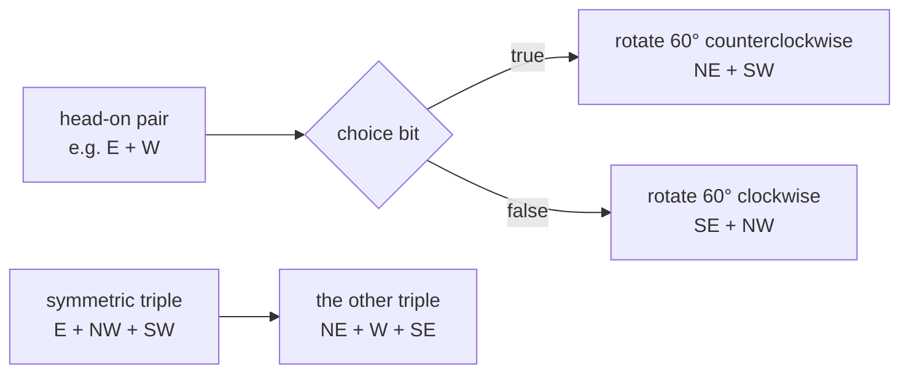

# Lattice gas primer

This page explains, with pictures, what the `lga` package does. A lattice gas
is an [automaton](automata-primer.md) whose bits are particles. Every snapshot,
average and answer below was produced by running Calx, with the pinned CaDiCaL
and DRAT-trim for the answers, not worked out by hand.
[`lga/primer_test.go`](../lga/primer_test.go) checks them by simulation,
without a solver.

For measured limits see
[validation](validation.md#measured-conservation-proofs-are-counting-arguments); for
the code path see [execution flow](execution-flow.md#5-automata-and-lattice-gases).

## 1. Particles as bits

`lga.HPP` is a grid of cells. Each cell has four bits, one per direction, and a
true bit means "a particle is leaving this cell in that direction":

| Bit | Constant | Direction | Drawn as |
| ---: | --- | --- | :---: |
| 0 | `lga.East` | +x | → |
| 1 | `lga.North` | +y | ↑ |
| 2 | `lga.West` | −x | ← |
| 3 | `lga.South` | −y | ↓ |

A cell holds at most one particle per direction, so the whole state is just
bits: cell (x, y) is cell `y*Width + x`, and its bit d is at index
`cell*4 + d`. The grid is periodic: leaving the right edge re-enters on the
left, and leaving the top re-enters at the bottom.

## 2. One step: stream, then collide

Every step does two things to every cell at once:



HPP's collision rule has only two cases. An exact head-on pair turns 90°, and
everything else passes through unchanged:

| Arriving | Leaving |
| --- | --- |
| → and ← only | ↑ and ↓ |
| ↑ and ↓ only | → and ← |
| anything else | the same particles |

Two particles on a 5×3 grid, simulated with `automaton.Simulate`:

```text
t=0              t=1              t=2              t=3              t=4              t=5
·  ·  ·  ·  ·     ·  ·  ·  ·  ·     ·  ·  ·  ·  ·     ·  ·  ↑  ·  ·     ·  ·  ↓  ·  ·     ·  ·  ·  ·  ·
→  ·  ·  ·  ←     ·  →  ·  ←  ·     ·  ·  ↑↓ ·  ·     ·  ·  ·  ·  ·     ·  ·  ·  ·  ·     ·  ·  →← ·  ·
·  ·  ·  ·  ·     ·  ·  ·  ·  ·     ·  ·  ·  ·  ·     ·  ·  ↓  ·  ·     ·  ·  ↑  ·  ·     ·  ·  ·  ·  ·
```

At t=2 the two particles meet in the middle cell and leave as ↑ and ↓. At t=4
they have wrapped around the top and bottom edges. At t=5 they meet again from
above and below and leave as → and ←.

## 3. Walls

`Walls` marks cells that reflect every arriving particle back the way it came.
On a 5×1 row with a wall in the last cell:

```text
t=0  →  ·  ·  ·  ▒
t=1  ·  →  ·  ·  ▒
t=2  ·  ·  →  ·  ▒
t=3  ·  ·  ·  →  ▒
t=4  ·  ·  ·  ·  ←      (the particle arrived at the wall cell and turned back)
t=5  ·  ·  ·  ←  ▒
t=6  ·  ·  ←  ·  ▒
```

▒ marks the wall cell when it is empty.

## 4. What is conserved

A collision never creates or destroys a particle, and a head-on pair has zero
total momentum before and after. So HPP conserves:

| Quantity | Helper | Conserved? |
| --- | --- | --- |
| Number of particles | `Mass()` | Yes, also with walls |
| East movers minus west movers | `MomentumX()` | Yes without walls; walls reverse momentum |
| North movers minus south movers | `MomentumY()` | Same as `MomentumX` |
| `MomentumX` of one row only | `RowMomentumX(y)` | Yes without walls |

The last row is a known flaw of the square lattice. A head-on east-west pair
turns into a north-south pair, so x momentum never moves from one row to
another. A real fluid does not behave like that, which is why HPP does not
reproduce real fluid flow. Calx keeps HPP because its invariants are known
exactly, which makes it a good test for the solver queries in section 7.

## 5. FHP: the hexagonal lattice

`lga.FHP` uses six directions at 60° steps, so momentum can spread in more
directions:

| Bit | Constant | Angle |
| ---: | --- | ---: |
| 0 | `HexE` | 0° |
| 1 | `HexNE` | 60° |
| 2 | `HexNW` | 120° |
| 3 | `HexW` | 180° |
| 4 | `HexSW` | 240° |
| 5 | `HexSE` | 300° |



A head-on pair can rotate either way, so FHP is **nondeterministic**: each
fluid cell has one choice bit per step, provided through `automaton.Chooser`.
`Simulate` and `FHP.Run` take a `choose` function for these bits; a solver
treats them as free variables. Wall cells have no choice bit.

## 6. From particles to flow

Single particles are noisy. `Density` and `Velocity` average over
block×block regions of cell indices (squares on HPP, parallelograms on FHP)
and over the states passed in. `examples/lga` starts a 16×8
grid with east movers in columns 0–3 and west movers in column 8, runs 8
steps and averages 4×4 blocks:

| | Start | After 8 steps |
| --- | ---: | ---: |
| Mass | 40 | 40 |
| x momentum | 24 | 24 |

| Block columns | x 0–3 | x 4–7 | x 8–11 | x 12–15 |
| --- | ---: | ---: | ---: | ---: |
| Density (particles per cell) | 0.25 | 0.25 | 0.75 | 0 |
| x velocity (momentum per particle) | −1 | 1 | 1 | 0 |

Both block rows give the same numbers, since every row started the same.

## 7. Asking the solver

Because an HPP or FHP value is an `automaton.System`, the same rule can be
compiled to CNF. A query with `Violates` asks: **is there any start state from
which this quantity changes at some step within k steps?** A run that changes
it and changes it back counts too.

```go
q := automaton.Query{Steps: 3, Violates: h.Mass()}
```

| Question | Answer | Meaning |
| --- | --- | --- |
| HPP 2×2, 3 steps, `Violates: Mass()` | UNSAT, proof checked | Every start state of this lattice keeps the same particle count at every time up to 3 |
| A broken rule on 4×4 that turns → ← into one ↑, 3 steps | SAT | The solver found a start state; the mass at times 0–3 was 37, 35, 34, 33. The counts depend on the solver's model; a hand-built pair that meets head-on goes 2, 1, 1, 1 |

The broken rule is in `examples/lga`, run with `-check`. A SAT answer is
decoded into a `Trajectory` and replayed with `automaton.Replay` before it is
trusted. The `lga` real-tool tests ask the same kind of questions for momentum,
per-row momentum, walls and FHP.

An UNSAT answer covers every start state of that lattice size and step count,
not larger lattices or longer runs. Conservation proofs are counting arguments
and get slow as lattices grow; see the
[measured limits](validation.md#measured-conservation-proofs-are-counting-arguments).

## 8. Run and Simulate

`automaton.Simulate` keeps every state and works for any System. `HPP.Run` and
`FHP.Run` pack 64 cells of one direction into one 64-bit word and return only
the final state; they give the same result as `Simulate`. On a 128×128 HPP
lattice for 20 steps, `Run` took 0.30 ms against 8.6 ms for `Simulate`.
