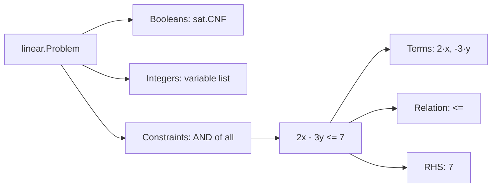
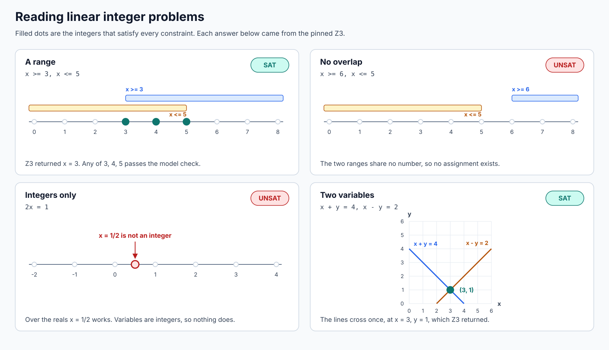

# Linear integer primer

This page explains, with pictures, what the `linear` and `linear/z3` packages do.
Every answer, SMT-LIB line and model below was produced by running Calx with the
pinned Z3 5.3.3, not worked out by hand.
[`linear/primer_test.go`](../linear/primer_test.go) checks the encodings and, by
enumerating small integers, the answers, without a solver.

Read the [SAT primer](sat-primer.md) first if SAT and UNSAT are new. For the exact
rules see [contracts](contracts.md#linear-integers).

## 1. Beyond true and false

A CNF only has Boolean variables, so "at most 5" over a number needs many clauses.
The `linear` profile states it directly: Boolean CNF, plus an AND of comparisons
between a sum of integer terms and a constant.



In Go a constraint spells out each part. Numbers are canonical decimal strings, so
they can exceed 64 bits and nothing rounds or overflows:

```go
p := linear.Problem{
	Integers: []sat.Variable{{ID: 1}},
	Constraints: []linear.Constraint{{
		Terms:    []linear.Term{{Variable: 1, Coefficient: "2"}},
		Relation: linear.AtLeast,
		RHS:      "18446744073709551616", // 2^64
	}},
}
```

Boolean and integer IDs are separate lists: Boolean 1 and integer 1 are different
variables, written `b1` and `i1` in the encoded form.

## 2. Four small problems

Z3 answered each of these:



| Constraints | Answer | Model |
| --- | --- | --- |
| `x >= 3`, `x <= 5` | SAT | `x = 3` |
| `x >= 6`, `x <= 5` | UNSAT | none |
| `2x = 1` | UNSAT | none |
| `x + y = 4`, `x - y = 2` | SAT | `x = 3`, `y = 1` |

The third problem is the one to remember: over the real numbers `x = 1/2` works,
but these variables are integers, so nothing does. Integer problems are not ordinary
algebra with rounding at the end.

## 3. What is in the profile

There are three relations: `=`, `<=` and `>=`. Other constraints can often be
rewritten into them, because the variables are integers:

| You want | Write | Why |
| --- | --- | --- |
| `x < y` | `x - y <= -1` | Integers have nothing between `y - 1` and `y` |
| `x > 3` | `x >= 4` | Same reason |
| `2x + 1 = y` | `2x - y = -1` | Variables go on the left, constants on the right |

An empty sum is zero. Everything is one AND, which sets the limit of the profile:

| Not in the profile | Why it matters |
| --- | --- |
| `x <= 3 OR x >= 7` | Comparisons cannot be alternatives; no disjunction mixes Booleans with arithmetic |
| `x * y` | Only constants multiply a variable |
| Quantifiers, arrays, SMT-LIB text | The input is typed, so there is no source to parse |

A Boolean clause and an arithmetic constraint can sit side by side in one problem,
but they share no variable, so neither affects the other. An unknown relation
returns `linear.ErrUnsupported`; malformed numbers and IDs return `sat.ErrInput`.

## 4. SMT-LIB, the solver's format

`WriteSMTLIB` encodes the typed problem exactly. The fourth problem becomes, with
the `(check-sat)` line that the runner appends:

```text
(set-logic QF_LIA)
(declare-const i1 Int)
(declare-const i2 Int)
(assert (= (+ 0 0 (* 1 i1) (* 1 i2)) 4))
(assert (= (+ 0 0 (* 1 i1) (* (- 1) i2)) 2))
(check-sat)
```

`QF_LIA` is the standard name for quantifier-free linear integer arithmetic. SMT-LIB
has no negative numerals, hence `(- 1)`. The `0 0` keeps every sum at two arguments
or more, as the standard requires, even when it has no terms.

## 5. Checking the answer

Z3 and CaDiCaL give different guarantees, and the difference is the important part:

```mermaid
flowchart TD
    p["linear.Problem"] --> save["save input.json and input.smt2"]
    save --> solver["pinned Z3"]
    solver -->|sat| second["second Z3 process:<br/>get every value"]
    second --> check["evaluate every original constraint<br/>with exact big integers"]
    solver -->|unsat| report["Z3's report only:<br/>no proof, nothing to check"]
    solver -->|unknown| unknown["ErrInconclusive"]
    check --> result["Result + artifacts"]
    report --> result
    unknown --> result
```



**SAT is checked.** For the fourth problem the second process printed:

```text
sat
((i1 3)
 (i2 1))
```

Calx parses that fixed form, requires a value for every variable, and evaluates the
typed problem with exact integers. It recorded the method
`total-bool-and-big-integer-evaluation/v0`. A wrong model cannot pass, whichever
solver produced it. The second process need not return the model the first one
found, because the check does not depend on it.

**UNSAT is not.** Nothing like DRAT-trim exists here, so the answer is Z3's word
alone. A consumer states what it needs, and the record shows the difference:

| Requirement | `sat/cadical` UNSAT | `linear/z3` UNSAT |
| --- | --- | --- |
| `Require(sat.Requirements{})` | passes | passes |
| `Require(sat.Requirements{UNSATProofChecked: true})` | passes | `sat.ErrGuarantee` |
| `Proof.Present` | true | false |

No backend is substituted when the guarantee is missing. If a conclusion must carry
a checked proof, encode it as CNF and use `sat/cadical`. Linear UNSAT suits uses
where a wrong "impossible" would cost little, or where another check follows.

A SAT query leaves `input.json`, `input.smt2`, the process records of `solver` and
`model`, `model.smt2`, `assignment.json` and `outcome.json`. An UNSAT query stops
after `solver`, so it has no `model` records and no `assignment.json`. `InputDigest`
identifies `input.json` and `FormulaDigest` identifies `input.smt2`, as in
[the SAT primer](sat-primer.md#5-what-a-result-records).

## 6. Shrinking a linear conflict

[`mus`](mus-primer.md) works here too, because `z3.Result` embeds `sat.Result`.
This Oracle treats each constraint as a group:

```go
type constraints struct {
	runner  *z3.Runner
	problem linear.Problem
}

func (o constraints) Groups() int { return len(o.problem.Constraints) }

func (o constraints) Check(ctx context.Context, step int, keep []bool) (sat.Result, error) {
	trial := linear.Problem{Booleans: o.problem.Booleans, Integers: o.problem.Integers}
	for i, c := range o.problem.Constraints {
		if keep[i] {
			trial.Constraints = append(trial.Constraints, c)
		}
	}
	solved, err := o.runner.Solve(ctx, fmt.Sprintf("core-%d", step), trial)
	return solved.Result, err
}
```

For `x >= 6`, `y <= 0` and `x <= 5`:

| Check | Left out | Answer | Result |
| ---: | --- | --- | --- |
| 0 | nothing | UNSAT | A conflict exists |
| 1 | `x >= 6` | SAT | Needed, put back |
| 2 | `y <= 0` | UNSAT | Removed |
| 3 | `x <= 5` | SAT | Needed, put back |

The core is `x >= 6` and `x <= 5`. Asking for a proof makes the run stop instead,
because check 0 cannot meet it:

```go
_, err := mus.Shrink(ctx, oracle, sat.Requirements{UNSATProofChecked: true})
// errors.Is(err, sat.ErrGuarantee)
core, err := mus.Shrink(ctx, oracle, sat.Requirements{SATModelChecked: true})
// core.Groups is [0, 2]; each UNSAT in it is Z3's report.
```

## 7. What an answer does not say

- **UNSAT here is unproved.** It is a good solver's report, not evidence that a
  separate program verified.
- **UNKNOWN, a timeout or a limit is not UNSAT.** They return errors such as
  `sat.ErrInconclusive`, `context.DeadlineExceeded` or `sat.ErrLimit`.
- **A model is one solution.** `x = 3` satisfies the first problem; it is not the
  only solution and not the smallest in any chosen sense. There is no optimization.
- **The checks cover the constraints, not their meaning.** Whether the numbers
  describe the original problem is the job of the code that wrote them.
