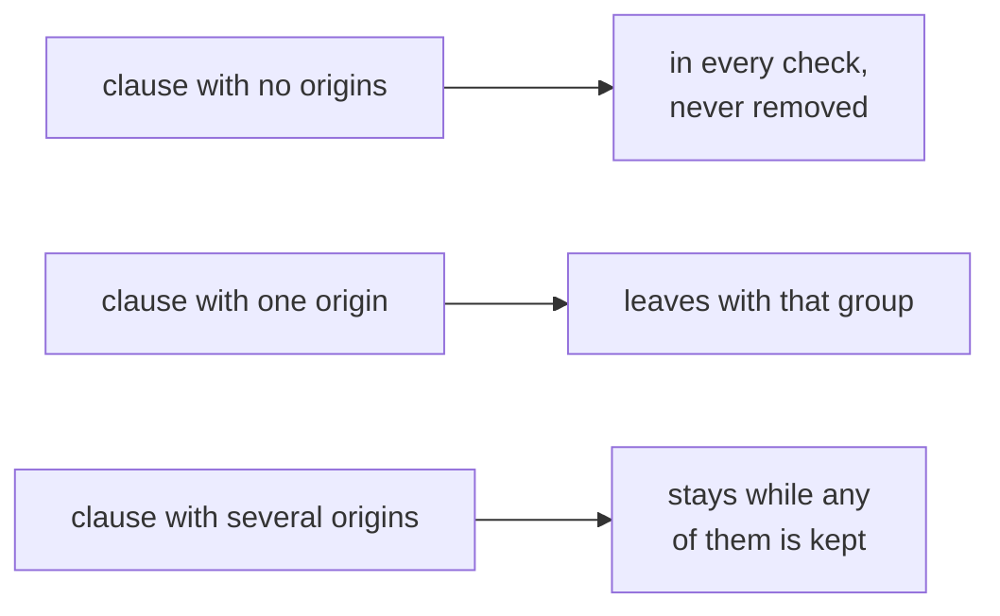
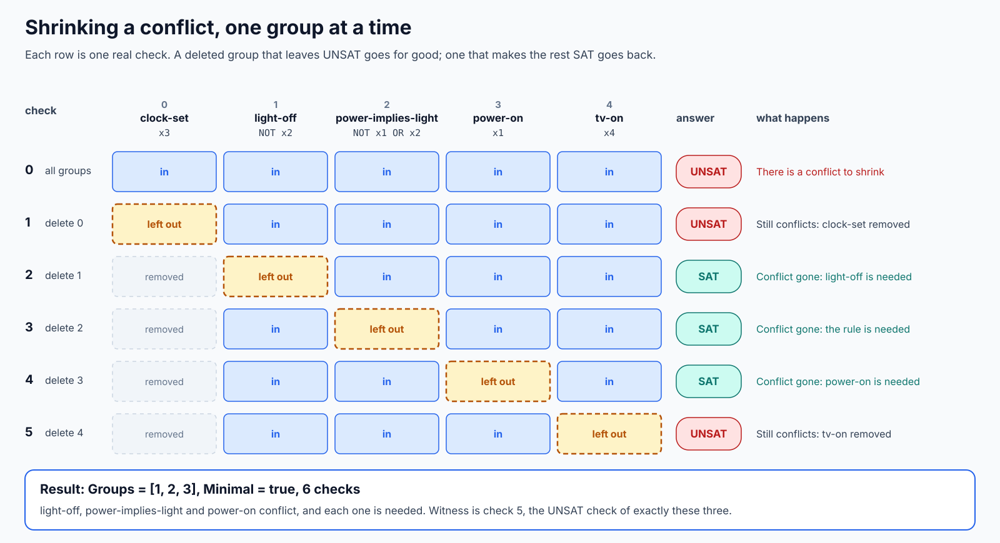
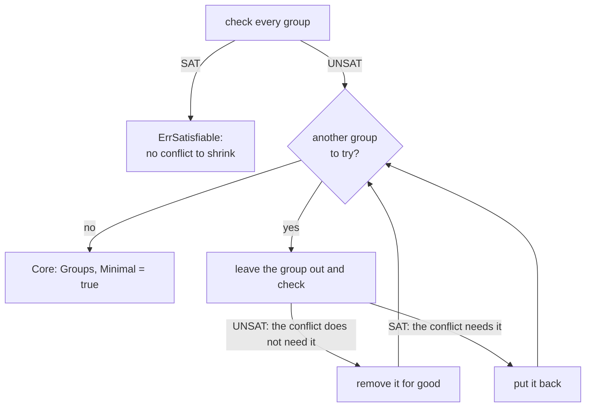
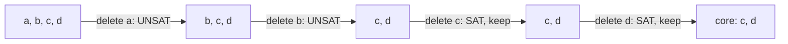
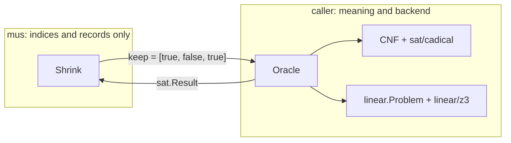

# Conflict localization primer

This page explains, with pictures, what the `mus` package does. It uses one
small formula throughout. Every check and answer below was produced by running
Calx with the pinned CaDiCaL and DRAT-trim, not worked out by hand.
[`mus/primer_test.go`](../mus/primer_test.go) checks the same sequences with an
independent enumerator, so `go test` fails if they stop being true.

MUS stands for *minimal unsatisfiable subset*. Read the [SAT primer](sat-primer.md)
first if SAT and UNSAT are new. For the exact rules see
[contracts](contracts.md#conflict-localization).

## 1. UNSAT says that, not where

Five statements about a house, each one a clause:

| Group | Clause | Meaning |
| --- | --- | --- |
| `clock-set` | `x3` | The clock is set |
| `light-off` | `NOT x2` | The light is off |
| `power-implies-light` | `NOT x1 OR x2` | If the power is on, the light is on |
| `power-on` | `x1` | The power is on |
| `tv-on` | `x4` | The television is on |

A solver answers UNSAT with a checked proof, and that is all. The answer covers
the whole formula: it does not separate the three statements that clash from the
two that have nothing to do with it. With thousands of clauses that is the
difference between "something is wrong" and something a person can act on.

`mus.Shrink` finds a subset that still conflicts and in which every statement is
needed. Here that subset is `light-off`, `power-implies-light` and `power-on`.

## 2. Groups

The unit of deletion is a **group**, which may be one clause or many. For a CNF,
`CNF.Origins` already says where each clause came from, so `mus.ByOrigin` uses each
distinct origin string as a group:

```go
formula := sat.CNF{
	Variables: []sat.Variable{{ID: 1}, {ID: 2}, {ID: 3}, {ID: 4}},
	Clauses:   [][]int{{3}, {1}, {-1, 2}, {-2}, {4}},
	Origins: [][]string{
		{"clock-set"}, {"power-on"}, {"power-implies-light"}, {"light-off"}, {"tv-on"},
	},
}
oracle, err := mus.ByOrigin(formula, solve)
```

Groups are sorted by name, so group 0 is `clock-set` whatever order the clauses
came in. `Origins` is otherwise opaque: nothing else in Calx reads it as logic, and
Calx never learns what `light-off` means.

Two rules cover the clauses that do not map to one group:



A clause with no origins is a fixed fact that shrinking must not touch. A clause
with several origins stays while any of them remains, because each origin is taken
to assert the clause on its own. If a clause really depends on two conditions
together, it should go when *either* goes, and that needs its own Oracle
([section 6](#6-your-own-oracle)).

## 3. Deleting one group at a time

The first check keeps every group. If that is not UNSAT there is nothing to shrink.
Then each group is left out in turn, in index order. Each row of this picture is
one real solver run:



The rule is short:



The result is a `mus.Core`:

| Field | Value here | Meaning |
| --- | --- | --- |
| `Groups` | `[1, 2, 3]` | `light-off`, `power-implies-light`, `power-on` |
| `Minimal` | `true` | Every remaining group had a satisfiable deletion |
| `Witness` | check 5, UNSAT | The check of exactly these three |
| `Steps` | 6 records | Every check made, in order |

Every UNSAT row here carried a proof checked by DRAT-trim, and every SAT row a
model checked against each clause. `Witness` is that evidence for the three groups
that remain, so the conflict can be rechecked without trusting the search.

## 4. Why nothing more can be removed

Check 2 left out `light-off` and got SAT, with `clock-set` already gone. Later
checks only remove more, so `light-off` is never tested against the final set
directly. That is still enough: **removing constraints can never turn a satisfiable
set unsatisfiable**. Anything that satisfies a set also satisfies every part of it.
Since the set without `light-off` was satisfiable, so is any smaller set without
it, so the final three need `light-off`.

Calx calls this property of an Oracle **monotone**. CNF clauses and linear
constraints have it automatically, and a custom Oracle must keep it for `Minimal`
to mean anything. Calx assumes it and does not check it.

## 5. One conflict, not the conflict

A formula can have several conflicts. Take two with nothing in common:

| Clause | `x1` | `NOT x1` | `x2` | `NOT x2` |
| --- | --- | --- | --- | --- |
| Named one way | `a` | `b` | `c` | `d` |
| Named the other way | `c` | `d` | `a` | `b` |

Both namings give the core `[c, d]`, and the two runs find different conflicts.
The first finds `x2` against `NOT x2`. The second finds `x1` against `NOT x1`.

Earlier groups are tried first, so they are removed whenever a later conflict can
stand without them:



So a caller who wants certain groups in the answer puts the others earlier, by name
with `ByOrigin` or by index in its own Oracle. Finding every conflict, or the smallest one, is a different and much
harder search, which `mus` does not do.

## 6. Your own Oracle

`mus.Oracle` works like `sort.Interface`: the caller implements a few methods and
Calx handles the algorithm using indices alone.

```go
type Oracle interface {
	Groups() int
	Check(ctx context.Context, step int, keep []bool) (sat.Result, error)
}
```



A group can be anything that can be left out: a set of constraints, a rule file, a
whole subsystem. `Check` builds the formula for the groups marked in `keep` and
solves it however it likes. `step` numbers the checks, which suits a unique query
ID. Because `Check` returns a `sat.Result`, and both `cadical.Result` and
`z3.Result` embed one, the same `Shrink` serves both backends. The
[linear primer](linear-primer.md#6-shrinking-a-linear-conflict) has an example.

## 7. When it stops early

The caller passes the guarantees it needs, and every check must meet them:

```go
want := sat.Requirements{SATModelChecked: true, UNSATProofChecked: true}
core, err := mus.Shrink(ctx, oracle, want)
```

Passing the zero value accepts unchecked answers, so that has to be a deliberate
choice. A run that stops early still reports what it established:

| Stopped by | Error | `Witness.Status` | What `Groups` means |
| --- | --- | --- | --- |
| Complete set is satisfiable | `mus.ErrSatisfiable` | not UNSAT | nil: no conflict |
| First check failed | the check's error | not UNSAT | nil: nothing established |
| UNKNOWN answer | `sat.ErrInconclusive` | UNSAT after check 0 | Still conflicts, may hold extra groups |
| Unmet requirement | `sat.ErrGuarantee` | UNSAT after check 0 | Still conflicts, may hold extra groups |
| Budget from `WithMaxChecks` | `mus.ErrBudget` | UNSAT | Still conflicts, may hold extra groups |
| Cancellation or deadline | `context` error | UNSAT after check 0 | Still conflicts, may hold extra groups |

For the house formula, `mus.WithMaxChecks(3)` stops after check 2 with
`Groups = [1, 2, 3, 4]`. That set still conflicts, but `tv-on` is still in it
and `Minimal` is false. Treat `Minimal` as the only sign that nothing is left to
remove, and treat UNKNOWN as "not decided": it is never read as SAT, which would
wrongly keep a group, or as UNSAT, which would wrongly remove one.

A run makes at most `Groups()+1` checks, so its cost is bounded before it starts.

## 8. What a core does not say

- **It does not say which group is wrong.** `light-off`, `power-on` and the rule
  conflict. Any one of them could be the mistake, and repairing it is the caller's
  decision.
- **It is not every conflict, or a smallest one.** Another group order can find a
  different core, and removing a core does not make the rest of the formula
  satisfiable.
- **It concerns the formula, not the world.** As in the
  [SAT primer](sat-primer.md#6-what-an-answer-does-not-say), the checks cover the
  encoded constraints. Whether they describe the original problem correctly is the
  encoder's responsibility.
