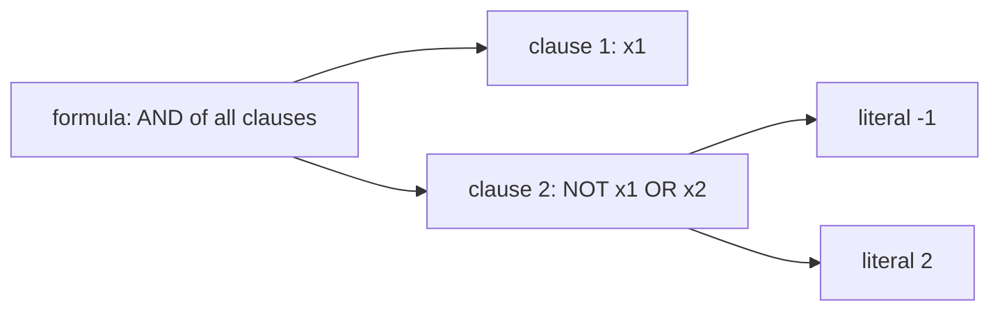
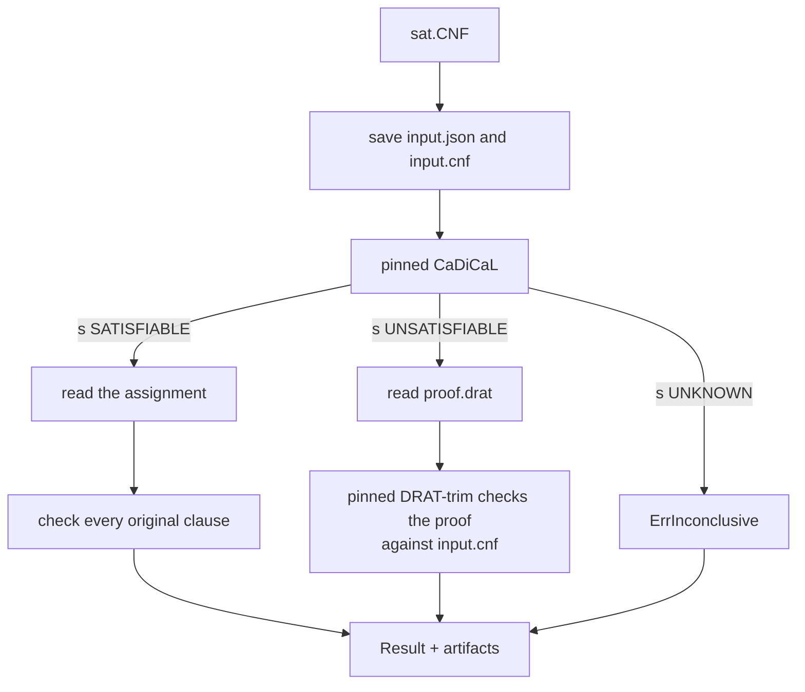
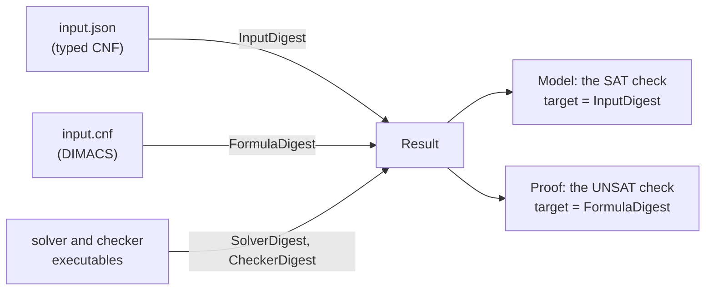

# SAT primer

This page explains, with pictures, what the `sat` package and its `cadical`
runner do. It uses two tiny formulas throughout. Every assignment check, DIMACS
line, proof and result field below was produced by running Calx with the pinned
CaDiCaL and DRAT-trim, not worked out by hand.
[`sat/primer_test.go`](../sat/primer_test.go) checks the formulas, assignment
checks and proof lines without a solver.

For the exact rules see [contracts](contracts.md); for the runner's internal
steps see [execution flow](execution-flow.md#3-logic-resolver-internals).

## 1. Variables, clauses and formulas

A Boolean variable is either true or false. Calx numbers variables from 1, so
`x1` is variable 1. A **literal** is a variable or its negation: `2` means x2,
`-1` means NOT x1.

A formula in **conjunctive normal form (CNF)** is an AND of clauses, and each
clause is an OR of literals:



The example formula `x1 AND (NOT x1 OR x2)` reads "x1 is true, and if x1 is
true then x2 is true". With two variables there are four assignments.
`CNF.CheckAssignment` reports the first clause each one breaks:

| x1 | x2 | `CheckAssignment` |
| :---: | :---: | --- |
| false | false | violates clause 0 (`x1`) |
| false | true | violates clause 0 (`x1`) |
| true | false | violates clause 1 (`NOT x1 OR x2`) |
| true | true | satisfied |

Clauses are numbered from 0. Two edge cases: a formula with no clauses is
true, and a clause with no literals is false.

In Go the formula is a `sat.CNF`:

```go
formula := sat.CNF{
	Variables: []sat.Variable{{ID: 1}, {ID: 2}},
	Clauses:   [][]int{{1}, {-1, 2}},
}
```

`Variable.Metadata` and `CNF.Origins` let a caller attach its own meaning to
variables and clauses; Calx stores them but never reads them as logic.

## 2. DIMACS, the solvers' format

Solvers read the DIMACS text format. `WriteDIMACS` prints the example as:

```text
p cnf 2 2
1 0
-1 2 0
```

The header says "CNF with 2 variables and 2 clauses". Each following line is
one clause, ended by `0`, which is why variable 0 cannot exist. `ReadDIMACS`
parses the same format back, within explicit size limits.

## 3. Three possible answers

A SAT solver answers one question: **is there any assignment that makes every
clause true?**

| Answer | Meaning | What comes with it |
| --- | --- | --- |
| SAT | At least one assignment works | One satisfying assignment |
| UNSAT | No assignment works | A proof that none exists |
| UNKNOWN | The solver gave up | Nothing to rely on |

The first formula is SAT. The second one has four clauses that rule out each
of the four assignments in turn:

```text
p cnf 2 4
1 2 0
-1 2 0
1 -2 0
-1 -2 0
```

| x1 | x2 | `CheckAssignment` |
| :---: | :---: | --- |
| false | false | violates clause 0 (`x1 OR x2`) |
| false | true | violates clause 2 (`x1 OR NOT x2`) |
| true | false | violates clause 1 (`NOT x1 OR x2`) |
| true | true | violates clause 3 (`NOT x1 OR NOT x2`) |

Listing every assignment works here, but n variables have 2ⁿ assignments. A
solver such as CaDiCaL never lists them all, so it can answer for formulas with
millions of clauses. The price is that its answer has to be checked.

## 4. Checking the answer

Calx does not trust the solver's word. Each answer is checked in a different
way:



**SAT is easy to check.** Put the assignment back into every clause. For the
first formula CaDiCaL returned `{"1":true,"2":true}`, and Calx recorded the
check method `total-assignment/every-input-clause/v0`.

**UNSAT needs a proof.** CaDiCaL writes a DRAT proof: a list of new clauses,
each following from the formula and the clauses before it, ending with the
empty clause, which is false. For the second formula the pinned CaDiCaL wrote
three lines; another solver may write a different valid proof:

| Proof line | Derived clause | Why it follows |
| --- | --- | --- |
| `1 0` | x1 | `x1 OR x2` and `x1 OR NOT x2` together |
| `2 0` | x2 | `NOT x1 OR x2` with x1 |
| `0` | empty, false | `NOT x1 OR NOT x2` with x1 and x2 |

DRAT-trim, a separate program, replays the proof and printed `s VERIFIED`.
Calx recorded the method `drat-trim/exit-zero-exact-verified`. Because the
checker is a separate program, a solver bug alone cannot turn a satisfiable
formula into a verified UNSAT.

## 5. What a result records

`Solve` returns a `cadical.Result` and an error. The result ties the answer to
the exact inputs and tools:



For the two example formulas:

| Field | SAT formula | UNSAT formula |
| --- | --- | --- |
| `Status` | SAT | UNSAT |
| `Model` | present, decoded, checked | not present |
| `Proof` | not present | present, checked |
| `Assignment` | `{1: true, 2: true}` | none |

Every file the runner wrote is listed in `Artifacts` with its digest and size,
so the evidence can be checked again later.

Before using a result, a caller checks the error and then states what it
requires:

```go
err = result.Require(sat.Requirements{SATModelChecked: true, UNSATProofChecked: true})
```

Require fails for UNKNOWN and for an answer whose check is missing or bound to
another input.

## 6. What an answer does not say

- **UNKNOWN, a timeout or a size limit is not UNSAT.** They return errors such
  as `sat.ErrInconclusive` or `sat.ErrLimit`, never a false "impossible".
- **The checks cover the formula, not its meaning.** A checked UNSAT proves
  that this CNF has no solution. Whether the CNF correctly describes the
  original problem is the job of the encoder, such as `finite` or `automaton`.
- **A result belongs to one input.** The digests let a caller confirm which
  formula an answer is about; an old result is not evidence for a new formula.

To see the same pipeline on a real model, read the [finite primer](finite-primer.md)
and the [automata primer](automata-primer.md). To go from an UNSAT answer to the
clauses behind it, read the [conflict localization primer](mus-primer.md). For
numbers rather than Booleans, read the [linear integer primer](linear-primer.md).
