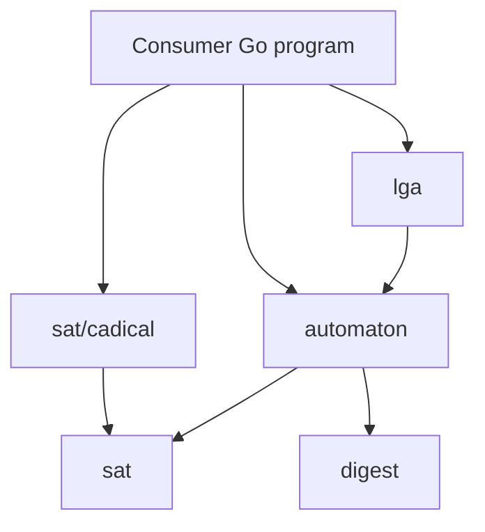

# v0.1 design: Boolean automata, lattice gases and tool manifests

Status: **all phases implemented**: the `automaton` core, conserved-quantity
violations, `lga` HPP, FHP with walls and bit-packed runs, and the CLI tool
manifest. This document fixed the v0.1 scope before any code was written and
records where the implementation differs. v0 remains as documented in
[architecture](architecture.md) and [contracts](contracts.md). The v0.1 work
did not change the API or behavior of `sat` and `sat/cadical`; later changes
removed `Result.Profile`, `ErrUnsupported` and the JSON tags of their types.

## Goals

1. **`automaton`**: bounded SAT analysis of synchronous Boolean automata supplied
   by the caller through a small interface. Queries are reachability,
   predecessors and conserved-quantity violations. Results use the existing
   checked solver path, and decoded trajectories are replayed.
2. **`lga`**: lattice gas automata (HPP first, then FHP) implemented on top of
   `automaton`. The package also runs forward simulations and coarse-grains them
   into density and velocity fields.
3. **CLI tool manifest**: replace the four solver/checker flags and the
   environment-variable setup with one reviewed manifest file.

## Non-goals

- No change to the public API or behavior of `sat` and `sat/cadical`.
- No unbounded proofs. UNSAT means "not within exactly k steps of this declared
  system", never "for all time".
- No asynchronous or interleaving systems. Use `finite` or an external model
  checker for those.
- No lattice Boltzmann method or floating-point solver. Floating point appears
  only in `lga` coarse-graining output.
- No CNF minimization. v0.1 uses canonical truth-table clauses.
- The CLI does not gain automaton or LGA commands in v0.1. Consumers are Go
  programs.

## Package layout

Arrows mean “imports”.



`automaton` produces a `sat.CNF`. The consumer solves it with its own
`cadical.Runner`, the same way the [finite Decode route](architecture.md#data-flow)
works today. Neither new package imports `sat/cadical`.

## automaton

### The System interface

The caller implements the system. Calx sees cell and bit indices and a local
rule, never what a cell or bit means. This is the same division of labor as
`sort.Interface`.

```go
// Bit addresses one state bit of one cell.
type Bit struct{ Cell, Index int }

// System is a synchronous Boolean automaton supplied by the caller.
type System interface {
	Cells() int                    // number of cells, 1..1,048,576
	Bits() int                     // state bits per cell, 1..16
	Inputs(cell int) []Bit         // bits that determine this cell's next state
	Next(cell int, in, out []bool) // local rule; out has Bits() entries
}

// Chooser is optional. A rule with choice bits is nondeterministic: Next
// receives len(Inputs(cell)) input values followed by Choices(cell) free bits.
type Chooser interface {
	Choices(cell int) int
}
```

Contract for implementations:

- `Inputs` and `Choices` return the same answer for the same cell for the
  lifetime of one call into `automaton`.
- `Next` is deterministic and pure. Calx may call it many times and in any
  order, but never concurrently.
- `len(Inputs(cell)) + Choices(cell)` is at most 12. The rule for a cell is
  therefore a table of at most 4,096 rows, which Calx enumerates.
- Calx does not recover panics from caller code, matching `sort`.

### State, patterns and quantities

```go
// State holds Cells()*Bits() values; bit (c, i) is at index c*Bits()+i.
type State []bool

// Pattern constrains some bits and leaves the rest free.
type Pattern map[Bit]bool

// Term is one signed contribution to a conserved quantity.
type Term struct {
	Bit    Bit
	Weight int // -1 or +1
}

// Quantity is a sum of signed bits, for example mass or one momentum component.
type Quantity []Term
```

### Queries

```go
type Query struct {
	Steps     int       // exact number of synchronous steps, at least 0
	Start     Pattern   // constraints at t = 0
	Goal      Pattern   // constraints at t = Steps
	Forbidden []Pattern // no state at any t may match one of these
	Violates  Quantity  // optional: require Q(t-1) != Q(t) for some step t
}

func Compile(ctx context.Context, sys System, q Query, opts ...Option) (*Encoding, error)
func (e *Encoding) CNF() (sat.CNF, error)
func (e *Encoding) Digest() (digest.Digest, error)
func (e *Encoding) Decode(values map[int]bool) (Trajectory, error)

type Trajectory struct {
	States  []State  // Steps+1 states
	Choices [][]bool // Steps entries; each is empty when there are no choice bits
}

func Replay(sys System, t Trajectory) error
func Simulate(sys System, start State, steps int, choose func(step, cell int) []bool) ([]State, error)
```

The common analyses map onto one query shape:

| Question | Query |
| --- | --- |
| Can `Start` reach `Goal` in exactly k steps? | `Steps: k, Start, Goal` |
| Does state `S` have a predecessor (Garden of Eden test)? | `Steps: 1, Goal: S` |
| Can quantity Q change at any step within k steps? | `Steps: k, Violates: Q` (UNSAT is a bounded conservation proof) |
| Does a broken rule get caught? | Same `Violates` query on a mutated `System`; expect SAT |

Functional options set the encoding budget (`WithMaxVariables`,
`WithMaxClauses`, `WithMaxLiterals`); omitted options keep the `sat.Limits`
defaults. Accessors
on a nil or uninitialized `Encoding` return an error, as in `finite`.

### Encoding

- **Variables.** `x(t, cell, bit)` for `t = 0..Steps`; `c(t, cell, j)` for choice
  bits at `t < Steps`; auxiliary counter variables for `Violates`. Implemented
  without per-variable metadata, unlike the original sketch: IDs follow a fixed
  layout instead (see [data structures](data-structures.md#synchronous-boolean-automata-v01)),
  so a 100,000-variable formula does not carry 100,000 metadata maps.
- **Transition.** For every cell, Calx enumerates `Next` once over all input
  assignments and caches the table. For each step, cell, output bit and table
  row, it emits one clause that forces the output bit to the table value when
  the inputs equal that row. A cell with n inputs plus choice bits therefore
  costs `Bits() * 2^n` clauses per step.
- **Patterns.** `Start` and `Goal` are unit clauses. Each `Forbidden` pattern
  becomes one blocking clause for every time 0..Steps.
- **Violates.** Calx splits Q into positive and negative parts. For each step
  t it compares `L = P(t−1) + N(t)` with `R = P(t) + N(t−1)` using totalizer
  unary counters, and one clause requires `L != R` for some step. (The first
  implementation, `synchronous-boolean/v1`, compared only times 0 and Steps,
  so a quantity that changed and changed back went unnoticed; v2 changed this
  on 2026-10-30.) Totalizer size grows faster than linearly with the
  number of terms, so conservation queries are intended for small lattices or
  for row and column quantities.
- **Budget.** Calx computes the variable, clause and literal counts before
  evaluating any rule or building any clause, and fails with `sat.ErrLimit`
  when they exceed the budget, as `finite` does for variables and clauses.

### Size estimates

These count the transition clauses only, using the default budget of 100,000
variables, 1,000,000 clauses and 4,000,000 literals. Each transition clause has
inputs + choices + 1 literals, so the literal budget is often the first limit.
The step counts were confirmed with `Compile`: 32×32 HPP accepts 12 steps and
rejects 13 (`TestDefaultBudgetSteps`), 16×16 FHP accepts 2 and rejects 3, and
32×32 FHP rejects even 1.

| Model | Grid | Inputs + choices per cell | Variables per step | Clauses per step | Steps within budget |
| --- | --- | ---: | ---: | ---: | ---: |
| HPP | 32×32 | 4 + 0 | 4,096 | 65,536 | about 12 (literals) |
| FHP-I with one choice bit | 32×32 | 6 + 1 | 7,168 | 786,432 | 0 (literals) |
| FHP-I with one choice bit | 16×16 | 6 + 1 | 1,792 | 196,608 | about 2 (literals) |

Larger runs need an explicitly larger budget, which the caller sets with the
budget options.

FHP needs small grids, a larger explicit budget or a later CNF minimization
step. Minimization is outside v0.1.

### What each answer proves

- **SAT.** `sat/cadical` checks the assignment against every clause, as it does
  today. `Decode` rebuilds the trajectory and `Replay` re-evaluates `Next` step
  by step. Replay uses the same rule source, so it checks the encoding, not
  whether the rule models anything real.
- **UNSAT.** The DRAT proof is checked against the emitted formula. The claim is
  limited to the declared `System`, the exact step count and the given patterns.

## lga

`lga` implements `automaton.System` for lattice gases and adds simulation and
coarse-graining.

- **Lattice.** One concrete type per model, starting with `HPP{Width, Height}`,
  with periodic boundaries in the first version. Cell index is `y*Width + x`.
  (Implemented as concrete types rather than the originally sketched
  `Lattice{Width, Height, Model}`, so each model owns its geometry.)
- **HPP.** 4 bits per cell in the order east, north, west, south; north
  increases y. A state holds the post-collision particles leaving each cell, and
  one step streams and then collides. With that convention each cell reads
  exactly 4 input bits, the arrivals from its neighbors; the opposite convention
  would need 16. The collision swaps an exact east–west head-on pair into
  north–south and back; every other configuration passes through.
- **FHP-I.** Hexagonal lattice with 6 bits per cell. The two-body head-on
  rotation direction is one choice bit through `Chooser`; true rotates
  counterclockwise. The caller supplies the choices to `Simulate` and `Run`.
  The lattice is implemented in axial coordinates on a periodic parallelogram
  instead of the sketched offset rows. Every cell then has the same six
  neighbor offsets, with no row-parity case. Momentum is exposed as the axial
  components `MomentumQ` and `MomentumR`, which have integer weights and so fit
  `automaton.Quantity`.
- **Walls.** `Walls []bool` on `HPP` and `FHP` marks bounce-back cells that
  reverse every arriving particle. They conserve mass but not momentum. A wall
  cell has no choice bit.
- **Quantities.** Helpers return `automaton.Quantity` values. HPP has `Mass()`,
  `MomentumX()`, `MomentumY()` and the per-row and per-column momenta
  `RowMomentumX(y)` and `ColumnMomentumY(x)`; FHP has `Mass()`, `MomentumQ()`
  and `MomentumR()`.
- **Simulation.** `automaton.Simulate` works for both models. `HPP.Run` and
  `FHP.Run` are bit-packed paths that return the final state, with one 64-bit
  word holding 64 cells of one direction. On a 128×128 HPP lattice for 20
  steps, `Run` took 0.30 ms against 8.6 ms for `Simulate`.
- **Flow fields.** `Density(states, block)` and `Velocity(states, block)` average
  over block×block regions of cell indices (squares on HPP, parallelograms on
  FHP) and over every state passed in, so the caller picks the
  time window by slicing the states. `Density` returns `([][]float64, error)`
  and `Velocity` returns `(ux, uy [][]float64, err error)`; a block that does
  not divide the lattice or an empty state list is an error.

HPP's square lattice is known not to reproduce isotropic Navier–Stokes flow; FHP
is the physically meaningful model. HPP is still the first target because its
invariants are known exactly, including the spurious per-row and per-column
momentum conservation, which makes it a ground-truth test for the analysis
queries.

## CLI tool manifest

Before v0.1, every `solve` and `solve-finite` call needed four tool flags, and
the README filled them from four exported environment variables computed with
`shasum`.
v0.1 replaces that with a manifest file:

```sh
bin/calx pin-tools --solver /path/to/cadical --checker /path/to/drat-trim --out tools.json
bin/calx solve-finite --in examples/finite.json --tools tools.json --artifacts artifacts/run
```

```json
{
  "schema_version": "calx-tools/v1",
  "solver":  {"path": "/path/to/cadical",   "digest": "<64 hex>"},
  "checker": {"path": "/path/to/drat-trim", "digest": "<64 hex>"}
}
```

- `pin-tools` hashes the files it is given. That is the same trust decision as
  the README's `shasum` step, but the result is a file that can be reviewed and
  committed in a consumer repository.
- `--tools` is mutually exclusive with the four existing flags. The flags remain
  available, because `internal/consumercheck` and existing scripts pass them.
- The manifest was first parsed in `internal/cli` (now `internal/toolmanifest`;
  see the follow-up below). `cadical.Config` is unchanged.
- Implemented differently: the Go examples keep reading `CALX_*` variables.
  Parsing the manifest belongs to the CLI side, and copying that parser into
  examples would create a second, unpublished format reader. The README's CLI
  setup no longer uses environment variables.
- The manifest has `schema_version: calx-tools/v1`, and its paths must be
  absolute. `pin-tools` refuses to overwrite an existing file.
- Follow-up (2026-10-27): the parser moved to `internal/toolmanifest`, and
  `calx-check-consumers` now requires `--tools` instead of reading `CALX_*`
  variables.

## Phases and verification

1. **`automaton` core**: `Compile` for reachability, predecessors and forbidden
   patterns, plus `Decode`, `Replay` and `Simulate`. Verification: on small 1-D
   rules (up to 6 cells, up to 3 steps) compare reachable and predecessor sets
   against brute-force enumeration, in the style of
   `internal/acceptance.Oracle`.
2. **Conserved-quantity violations**: the totalizer encoding, verified against
   brute-force quantity comparison on the same small systems.
3. **`lga` HPP**:
   - Exhaustive check that all 16 collision entries conserve mass and momentum.
   - An independent grid implementation of HPP matches `automaton.Simulate`.
   - Time reversal: with one step F = C∘S, the start is recovered as
     C(R(F^k(R(C(end))))), where R reverses directions.
   - With the real tools (`resolverintegration` tag): mass and momentum
     violation queries are UNSAT; a mutated collision entry gives SAT with a
     replayable counterexample; row momentum is UNSAT.
   - Dropped: a cross-check of a 3-cell lattice through `finite`. `finite` caps
     a model at 64 actions and uses simple-path, first-hit semantics, so a
     synchronous HPP step does not fit it beyond one cell. The independent
     grid implementation above is the second arm instead.
   - A density and velocity averaging test.
   - Measured result: whole-lattice conservation proofs do not scale (see
     below), so the real-tool test proves whole-lattice sums on 2×2 and keeps
     counterexample search, row and column sums and reachability on 4×4.
4. **FHP, walls and a bit-packed simulation path.**
   - The FHP-I table, checked for every state and both choices, conserves mass
     and momentum and is undone by the opposite choice.
   - A single particle moves to the expected axial neighbor in every direction.
   - Exhaustive one-step conservation on 2×1 and 1×2 FHP and on a walled
     lattice; walls reflect particles.
   - `Run` equals `Simulate` for HPP and FHP on widths 1, 2, 3, 63, 64, 65 and
     130, with and without walls, including 150-step runs on two-word rows.
   - With the real tools: FHP mass and both momenta conserved on 2×1; a broken
     pair rule gives a mass counterexample; a head-on pair can rotate either
     way but cannot pass straight through; HPP walls conserve mass and give a
     momentum counterexample.
5. **CLI tool manifest.** This phase is independent of the others and can land
   at any time.

Each phase updated the scope sentence in [architecture](architecture.md), the
README package table, [contracts](contracts.md) and
[data structures](data-structures.md) as it landed. In the committed history
those documentation changes are combined into one docs commit. `make verify`
and `make race` passed at each phase.

## Measured: conservation proofs are counting arguments

Phase 3 ran `Violates` queries on HPP with the pinned CaDiCaL and DRAT-trim and
a 90-second limit. These runs used `synchronous-boolean/v1`, which compared
only times 0 and Steps; under v2 the clause counts are larger (for example
1,026 / 3,076 for the first row):

| Lattice | Quantity | Terms | Steps | Clauses | Result |
| --- | --- | ---: | ---: | ---: | --- |
| 2×2 | mass | 16 | 1 / 3 | 1,025 / 1,537 | UNSAT in 0.5 s |
| 3×3 | mass | 36 | 1 / 3 | 3,921 / 5,073 | timeout |
| 4×4 | mass | 64 | 1 | 10,753 | timeout |
| 4×4 | momentum y | 32 | 1 / 2 | 3,713 / 4,737 | timeout / 10.8 s |
| 4×4 | momentum x | 32 | 3 | 5,761 | UNSAT in 1.5 s |

On 2026-10-27, FHP 2×2 mass (24 terms, 2 steps, 7,745 clauses) was UNSAT in
28 s with the same CaDiCaL and no proof output. The pure-Go solvers gophersat
(27.7 s) and gini (timeout at 60 s) did no better.

The formulas are small; the difficulty is the proof. Showing that a sum is
unchanged requires counting, which resolution-based CDCL does not find
efficiently. Counterexamples for broken rules are found in about 0.01 s on 4×4,
and row and column sums are proved in about 0.1 s.

### Per-step comparison (2026-10-30)

`synchronous-boolean/v2` compares every pair of consecutive times instead of
the first and last time. Before the change, three encodings were measured on
the cases above with the same tools and limit: endpoints (v1), time 0 against
every later time, and consecutive times (v2). All answers were checked and
every SAT run was replayed. One run per case:

| Case | Steps | v1 endpoints | time 0 vs every time | v2 consecutive |
| --- | ---: | --- | --- | --- |
| One cell negated each step, mass | 2 | UNSAT, 0.65 s | SAT, 0.09 s | SAT, 0.09 s |
| Broken HPP rule, 4×4 mass | 3 | SAT, 0.10 s | SAT, 0.11 s | SAT, 0.12 s |
| HPP 2×2 mass | 1 | UNSAT, 0.37 s | UNSAT, 0.37 s | UNSAT, 0.37 s |
| HPP 2×2 mass | 3 | UNSAT, 0.65 s | UNSAT, 2.44 s | UNSAT, 2.07 s |
| HPP 4×4 momentum x | 3 | UNSAT, 1.66 s | UNSAT, 4.20 s | UNSAT, 0.63 s |
| HPP 4×4 row 1 momentum x | 3 | UNSAT, 0.63 s | UNSAT, 0.47 s | UNSAT, 0.29 s |
| HPP 4×4 momentum y | 2 | UNSAT, 9.66 s | timeout | timeout |
| FHP 2×2 mass | 2 | UNSAT, 61.9 s | timeout | timeout |
| HPP 4×4 momentum y; HPP 3×3 mass; HPP 4×4 mass | 1 or 3 | timeout | timeout | timeout |

Times include the proof check. The first row shows the semantic difference:
the mass goes 0, 1, 0, so only the per-step encodings find the change. With
one step all three encodings are logically equivalent; v2 adds one variable
and one clause. Counterexamples and
few-term quantities are as fast or faster with v2; multi-step whole-lattice
proofs are slower, and two that v1 finished now time out.

Consequence for users: use `Violates` to find counterexamples and to prove
quantities with few terms. Without Start, Forbidden or Goal patterns, prove a
whole-lattice quantity with `Steps: 1`, which covers every state and so every
step count. A whole-lattice conservation law is better
established by checking each cell's rule table locally, which is exact and
covers every step count. That local check is a candidate for a later phase; it
is not part of v0.1.

## Resolved questions

- The package names stayed `automaton` and `lga`.
- The fan-in cap is 12 bits per cell, inputs plus choices.
- Bounce-back walls landed in phase 4, for both HPP and FHP.
